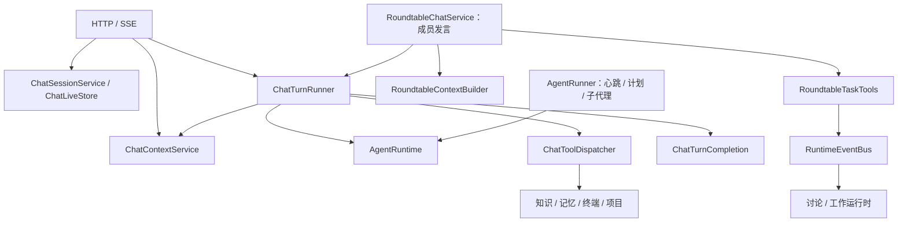

# 后端架构与协作入口

本项目采用按功能组织的模块化单体。Spring 负责依赖注入，SQLite 保存会话、任务和过程正本；模型调用无状态，执行状态通过调用参数、作用域和持久化记录传递。

参考 [Anthropic 的 Building effective agents](https://www.anthropic.com/engineering/building-effective-agents) 中简单、可组合的工作流与 Agent 循环，以及 [LangChain4j 的 Agent 文档](https://docs.langchain4j.dev/tutorials/agents/) 对执行、观测和人类参与的区分。这里采用职责划分，不为对齐框架而新增框架依赖。

## 阅读顺序

1. `web/controller/ChatController`：HTTP 与 SSE、断线续传，对接对应应用服务。
2. `agent/chat/ChatTurnRunner`：单轮任务登记、流式回调、停止、回复和过程落库；通过 `ChatExecution` 接入圆桌。
3. `agent/runtime/AgentRuntime`：唯一的模型 → 工具 → 模型循环，通过回调交付过程与结果。
4. `agent/chat/ChatContextService`：单聊请求体与原始上下文预览，共用 `agent/context/ContextBuilder` 和历史回放。
5. `agent/chat/ChatToolDispatcher`：校验后分发给知识、终端、计划、子代理、待办和项目能力。
6. `agent/chat/ChatTurnCompletion`：回答完成后的记忆采集、工作检查点、自动命名和通知。

## 模块职责

| 模块 | 职责与边界 |
| --- | --- |
| `web` | 请求校验、HTTP 状态码、SSE 传输；不组装模型请求或执行工具 |
| `agent/chat` | 单聊用例、会话管理、运行中的输出、子代理结论投递 |
| `agent/roundtable` | 成员发言、话题状态、讨论调度、共享任务执行；公开记录和局面组装归 ContextBuilder，共享任务修改和事件归 TaskTools |
| `agent/runtime` | 模型循环、独立任务执行、任务状态、工具执行记录、恢复与事件 |
| `agent/context` | 按稳定顺序组合历史、知识、记忆、待办和子代理状态 |
| `ai/core` | 提示词、工具协议、参数校验、作用域与公共值类型 |
| `ai/llm` | 模型 HTTP 协议与流式解析 |
| `ai/knowledge`、`ai/memory`、`ai/terminal` | 各自的能力与存储，不回调 Agent 编排层 |
| `ai/comfyui` | 独立的远程工作流绘图能力：端点与档案配置、提交与等待、图片持久化；工具适配位于 `integration`，其他功能直接调用 `ComfyUiService` |
| `project` | 项目与跨会话进度数据；用户与 Agent 的项目操作共用 ProjectWorkflowService |
| `todo` | 个人事项、真实投入、每日回顾和历史统计；按登录用户隔离，仅关联已有项目标签，不复用 Agent 执行任务或会话进度 |

## 抽象的取舍

- 删除纯转发的 `ChatService`；控制器按用例对接会话、执行、观测和续传服务。流式契约归 `ChatStream`。
- `TaskRunner` 只有 `AgentRunner` 一个实现，且调用方没有实际的替换机制；将输入、结果、工具回调并入 `AgentRunner`，直接注入它。
- `ConversationOrchestrator` 只有圆桌一个实现，单聊也没有走这份事件接口；将快照并入 `RoundtableDiscussionRuntime`，保持两种会话独立编排。
- 保留 `ChatExecution`：单聊和圆桌实际提供不同的会话落点、上下文和工具规则，共用一次执行流程。
- 保留 `ContextProvider` 和 `SpeakerStrategy`：已有多种实现，分别组合不同上下文和支持用户选择发言策略。
- 保留 chat 包定义的子代理端口：它们隔离模块依赖，避免工具派发、后台执行和结论投递形成构造环。

增加接口应有实际的多个实现或明确的模块依赖隔离目的。拆类应围绕能独立说明、测试和修改的职责；不要按每个步骤机械地建立 Service、Factory 或 Manager。新能力优先放入现有能力域，编排只负责连接它们。

## 人与 AI 如何修改和核查

| 想修改的行为 | 首先查看 |
| --- | --- |
| 请求、停止、SSE 与续传 | ChatController、ChatTurnRunner、ChatStream、ChatLiveStore |
| 人格、历史预算、工具面和上下文预览 | ChatContextService、ContextBuilder、History |
| 单聊工具路由 | ChatToolDispatcher；工具本身仍负责授权 |
| 轮末记忆归属与任务检查点 | ChatTurnCompletion |
| 圆桌公开记录裁剪和当前局面 | RoundtableContextBuilder |
| 主控权限、共享任务与依赖、单项派工、整体验收 | RoundtableTaskTools、CollaborationPlan |
| 谁运行、插话、中断和过期结果 | RoundtableDiscussionRuntime、RoundtableWorkRuntime、RoundtableRevision |
| 模型往返和原生工具消息协议 | AgentRuntime、ChatProtocol |

改动必须保留以下协作行为：停止后保存已经产生的部分答复；失败任务可观测、会话可继续发送；原始上下文预览与实际发送共用组装路径；工具授权与记忆隔离仍在原能力边界执行；主控统一处理执行受阻，按需请求相关成员讨论或等待用户拍板。

`LayeringTest` 检查能力域不反向依赖编排，以及编排不依赖 Web 控制器、上下文组装不执行模型或工具。执行内核、历史窗口、任务状态、记忆与项目续接由各自回归测试验证。测试使用模型替身，不代表真实供应商接口或浏览器端到端验证。

2026-10-13 本次整理聚焦单聊执行与圆桌发言两个主要入口。知识入库、心跳和其他大型模块保留原有行为，后续整理应继续依据实际调用链，而非单凭文件行数拆分。
