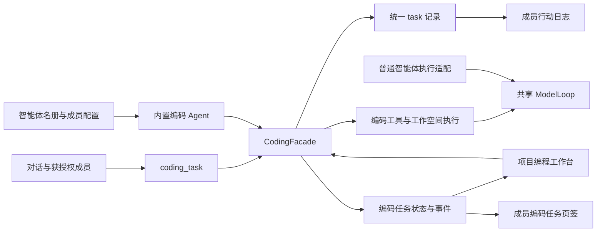

# 编码 Agent 与智能体体系统一

2026-10-14。内置编码 Agent 现已成为智能体名册中的实际成员。智能体页管理它的名称、模型和提示词；编程工作台负责项目、代码过程与审阅。两个入口读取和操作同一份任务，编码业务仍保留在独立 Java 包中。

## 用户入口

1. 在“智能体 → 成员”中看到“编码 Agent”，标记为内置，不可删除；点开默认进入“编码项目与任务”。
2. 左侧资料设置名称、模型、角色和备注；“提示词 & 上下文工程”修改它自己的提示词，不会改写“助手”的全局身份。
3. “我的编码任务”读取当前登录用户的工作台任务；运行中任务自动同步状态，也可以手动刷新。点任务进入同一项目、同一 runId 的工作台。
4. 工作台的 Agent 标题和起始页入口可以返回该成员配置页。名称和默认模型来自成员配置，当前任务的模型单独展示。
5. 首页已有的智能体选择器使用统一名册，因此可以选择编码 Agent 对话。对话可以通过 `coding_task` 查项目、发起任务并返回工作台链接。
6. 在其他成员的“能力 → 编程”中授予 `coding_task` 后，具备当前用户身份的执行可委派同一个编码 Agent。该工具不会作为默认只读检索工具自动授予。

普通登录用户仍可在已启用工作空间中新建/打开项目。SSH 的 root 与应用 SSO 角色是不同身份，不需要提升为应用管理员。

## 统一的对象与执行

| 对象 | 实现 |
| --- | --- |
| 固定身份 | `ai.core.BuiltinAgents.CODING`，值为 `builtin-coding` |
| 名册 | `coding.integration.CodingAgent` 在启动时幂等创建真正的 `agent` 行，使用现有 AgentStore |
| 身份提示词 | 首次播种该成员自己的 identity 版本和绑定；已有成员不覆盖名称、模型或提示词配置 |
| 配置读取 | CodingAgent 读取 AgentStore / AgentPromptService，工作台 capabilities 返回同一成员的 id、名称和模型 |
| 新任务模型 | 用户任务级指定 → 编码 Agent 指定 → 设置页默认 → env；保存选中的模型 ID |
| 对话模型 | 无请求级覆盖时使用所选智能体的模型；显式覆盖仍优先，跟随成员的选择不会被自动存成会话覆盖 |
| 提示词快照 | 新任务保存成员提示词；编码运行契约另行追加，PLAN/EDIT/EXECUTE 的工具边界仍由后端授权 |
| 任务根记录 | 每个 coding_run 关联同一条现有 task，`agent_id=builtin-coding`；状态更新继续同步该 task |
| 委派关联 | 对话委派记录来源 `session_id` 与 `agent.delegated` 事件，重复幂等请求不重复关联事件 |
| 运行作用域 | 编码 worker 设置 AgentScope 和已认证 UserScope；圆桌议程与执行线程捕获当前用户身份后传递 |
| 页面联通 | 成员新增 `executionKind=CODING`；编码任务页签读取工作台 API；行动日志通过 codingRunId 打开同一任务 |

新增 `coding_run_agent` 表保存任务的成员身份、原请求模型选择和提示词快照。默认模型最终解析出的 ID 与原请求的空选择分别存储，避免修改成员配置后，重试原幂等请求变成“另一个请求”。已有表不增加或重命名列。

启动恢复将既有 `origin=coding`、`kind=code` 且未归属智能体的 task 标到编码 Agent 名下，不覆盖其他已有归属。旧任务的检查点与输入保留；历史任务没有新的提示词快照时沿用已有检查点，不强制迁移成另一套人格或项目。

`engine/context/repository/runner/store` 不依赖智能体成员实现；成员配置适配位于 `coding.integration`，通过字符串快照传给上下文。共享 ModelLoop 继续保持与 Coding、Agent、Memory 和 Web 业务解耦。分层测试通过。

## 互联权限

`coding_task` 支持：

| action | 行为 |
| --- | --- |
| list | 获取当前用户项目、仓库与编码 Agent 信息 |
| start | 发起 PLAN 分析或 EDIT 修改，立即返回任务与链接 |
| read | 按当前用户身份读取状态、回答与验证结果 |
| message | 向运行中的 PLAN/EDIT 任务补充 input |
| resume | 继续可恢复的 PLAN/EDIT 任务，不自动确认未知操作 |
| cancel | 停止当前用户的任务 |

此入口不授予 EXECUTE，也不能通过继续或补充指令绕过现有执行任务的工作台授权。应用变更、未知操作确认、提交/推送/部署不会由此工具自动执行。受理只是异步任务已建立，不代表完成或验证通过。

没有已认证用户身份的后台心跳/子代理调用会明确拒绝访问用户项目，不假定某个用户、root 或管理员身份。此次打通了由用户请求启动的对话和圆桌线程身份传递；尚未为独立定时任务或后台恢复引入新的持久化用户授权机制。

编码任务 API 继续按用户隔离。智能体行动日志中的编码任务也按当前用户过滤，避免统一到一个内置成员后把其他用户的编程任务显示出来。成员配置仍使用系统原有的共享名册模型，此次不新增完整的多租户成员配置 ACL。

智能体页“工作空间绑定”仍控制圆桌中直接使用终端工具的目标；编码任务的工作空间由项目确定。成员工具列表不替代任务模式授权，编程模型不会收到其他聊天工具的全量列表。

## 验证与生效

- 后端选定 57 项回归全部通过：共享配置/身份、名册接口、任务所有者过滤、对话委派、模型快照与幂等重试、异步用户作用域、普通聊天与圆桌议程、编码权限/存储/工具边界、架构分层。
- 其中 Gateway 测试运行真实 CodingFacade 编排，模型循环、工作空间和文件工具为模拟对象；验证编码 worker 的 AgentScope/UserScope，没有真实网络、命令或文件操作。
- 前端路由和回答状态 5 项测试通过。
- 完整生产 App 的离线浏览器交互 19 项通过。新增检查覆盖成员卡片、内置删除保护、同一任务双向跳转、任务状态自动同步，以及保存成员名称/模型后更新工作台入口与默认模型。前 15 项页面回归仍通过，四套主题和窄屏布局未出现页面异常。
- 前端 TypeScript/Vite 构建和后端离线打包成功。定向 lint 0 错误，有 effect 状态同步与既有混合导出的 Fast Refresh 提示；Vite 已有的大包提示仍存在。
- 真实模型、SSH/Docker 命令、后台恢复和接受文件链路未重测；之前受沙箱阻断的测试未重试。

浏览器检查读取真实 `frontend/dist`，拦截全部资源与 API，以普通用户固定数据验证界面。保存配置也写入拦截数据，未修改实际数据库。运行记录由后端 MockMvc / 内存 SQLite / 模拟模型测试分别覆盖，不能将浏览器示例任务视为真实编程结果。

源代码与构建产物已更新，运行中的服务未替换。部署新后端并重启时自动播种内置成员、初始化新表；前端需使用新构建。

## 界面验收图

截图来自生产 App 与拦截数据。

