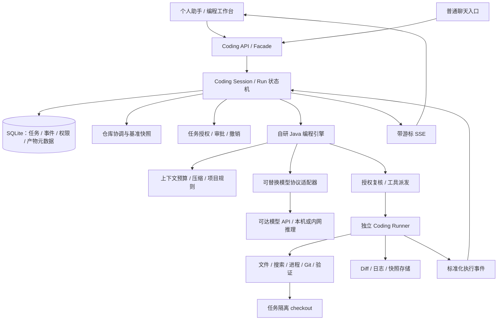

# 个人助手 AI Coding：可行性评估与架构方案

评估日期：2026-10-14。状态：评估后已按用户授权落地首版基础实现，真实执行链路待环境验收。本文件保留实施前评估与长期目标；最终代码范围和核查结果见 [首版实现与验收](D:/Static/worktable/ginpika-page/minis/docs/AI-Coding首版实现与验收-2026-10-14.md)。路线为全面自研 Java；Claude/Codex SDK 仅保留为对照资料，不作为运行依赖。

## 1. 结论与建议

**可行，现有后端适合增加独立的编程业务包。保留 Spring Boot 模块化单体，全面自研 Java 编程 Agent；编程业务归入独立 Coding 模块，模型通过可替换的推理端点接入。**

用户明确选择全面自研，主要原因是网络条件不适合依赖 Claude Agent SDK。Java 后端管理模型循环、上下文、工具、权限、任务和交付；独立 Runner 执行文件操作与项目命令。首版使用已经可达的模型端点，后续可接本机/内网模型服务。自研的是 Agent 编程系统，不包含从零训练基础大模型；最终效果取决于模型能力、工具设计和真实任务评测。

这里将“单独的包”理解为独立 Java 业务包 `cc.ginpika.minis.coding`，而不是立即拆微服务或 Maven 多模块。编程业务、HTTP 接口、配置、持久化和执行适配都归这个包；必要的现有入口调用和共享基础设施接线是少量外围改动。Agent 系统本身不新增 Claude/Codex SDK 或 Node/Python 编排依赖；被编程的项目仍可以使用自己的语言和构建工具。

首版目标是稳定完成“理解真实仓库 → 修改多个文件 → 构建/测试 → 提供 Diff 与证据 → 用户继续或接受修改”的闭环。达到这个目标后，再加入语义代码检索、复杂并行协作、Skills/MCP 和更长时程的自主任务。

本次没有调用真实模型、连接实际 Docker/SSH 环境，也没有读取 `.env`、生产数据库或供应商凭证。因此模型可用性、账号权限、网络可达性和真实执行资源是 P0 要验证的条件。

## 2. 当前后端：基础已经存在，但还不是编程执行平台

当前是 Java 21 + Spring Boot 3.5.16 + SQLite/JdbcTemplate + OkHttp 的模块化单体。桌面壳为 Tauri，既能启动本机 Java 后端，也能连接远程部署。生产 Compose 将前端、后端分开，当前后端镜像提供 JRE 和浏览器运行环境，没有配置代码仓库卷或 Coding Runner。

| 现有能力 | 实际代码证据 | 对 Coding 的判断 |
| --- | --- | --- |
| 统一模型/工具循环 | [AgentRuntime.java](D:/Static/worktable/ginpika-page/minis/backend/src/main/java/cc/ginpika/minis/agent/runtime/AgentRuntime.java:184) | 可参考、可在自研路线中演进；当前仍绑定 Chat Completions、聊天 DTO 和 Memory 生命周期 |
| 工具注册与分面 | [ToolManager.java](D:/Static/worktable/ginpika-page/minis/backend/src/main/java/cc/ginpika/minis/ai/core/tool/ToolManager.java:36)、[ToolSurface.java](D:/Static/worktable/ginpika-page/minis/backend/src/main/java/cc/ginpika/minis/ai/core/tool/ToolSurface.java:8) | 可复用协议；当前没有 CODING 工具面，不能把普通聊天工具全集交给编程任务 |
| 会话历史与预算裁剪 | [History.java](D:/Static/worktable/ginpika-page/minis/backend/src/main/java/cc/ginpika/minis/agent/chat/turn/History.java:197) | 已有按 Turn 裁剪；不能替代长编程任务中每次模型调用前的上下文管理 |
| 子 Agent 与后台执行 | [SubagentService.java](D:/Static/worktable/ginpika-page/minis/backend/src/main/java/cc/ginpika/minis/agent/subagent/SubagentService.java:66) | 已有独立上下文和结果回流；现有匿名子 Agent 的默认工具偏知识检索，不是代码 Worker |
| Docker/SSH 终端 | [ExecTarget.java](D:/Static/worktable/ginpika-page/minis/backend/src/main/java/cc/ginpika/minis/ai/terminal/ExecTarget.java:28)、[TerminalService.java](D:/Static/worktable/ginpika-page/minis/backend/src/main/java/cc/ginpika/minis/ai/terminal/TerminalService.java:150) | 有连接、超时、输出限制和目标授权基础；每次命令是新进程，没有进程句柄、持续输出、stdin 与任务级取消 |
| 文件浏览 | [WorkspaceService.java](D:/Static/worktable/ginpika-page/minis/backend/src/main/java/cc/ginpika/minis/agent/workspace/WorkspaceService.java:77) | 是人工页面的目录/预览/下载服务；不是模型文件工具、补丁服务或代码搜索服务 |
| 任务身份和产物 | [TaskStore.java](D:/Static/worktable/ginpika-page/minis/backend/src/main/java/cc/ginpika/minis/agent/runtime/TaskStore.java:33) | 已预留 KIND_CODE，但尚无完整 Coding 用例；beginExec 的来源映射目前只有 subagent/plan |
| 恢复与工作检查点 | [TaskRecovery.java](D:/Static/worktable/ginpika-page/minis/backend/src/main/java/cc/ginpika/minis/agent/runtime/TaskRecovery.java:41)、[TaskCheckpointService.java](D:/Static/worktable/ginpika-page/minis/backend/src/main/java/cc/ginpika/minis/agent/runtime/TaskCheckpointService.java:26) | 启动时收敛残留任务为 interrupted，并恢复部分工作状态；不能恢复原命令进程或直接续跑代码副作用 |
| 变更集 | [ChangeSetStore.java](D:/Static/worktable/ginpika-page/minis/backend/src/main/java/cc/ginpika/minis/agent/runtime/ChangeSetStore.java:52) | 当前主要记录工具参数/摘要，before 和 target 未实现；不能作为代码 Diff/回滚正本 |
| 事件与 SSE | [RuntimeEventStore.java](D:/Static/worktable/ginpika-page/minis/backend/src/main/java/cc/ginpika/minis/agent/runtime/event/RuntimeEventStore.java:61)、[EventController.java](D:/Static/worktable/ginpika-page/minis/backend/src/main/java/cc/ginpika/minis/web/controller/EventController.java:47) | 事件持久化、幂等和游标续传的模式可复用；新编程事件应有自己的事实记录和投影 |
| 模块边界守门 | [LayeringTest.java](D:/Static/worktable/ginpika-page/minis/backend/src/test/java/cc/ginpika/minis/arch/LayeringTest.java:31) | 现有层次清晰，应扩展架构规则保护新包，避免把编程能力塞进聊天执行器 |

### 2.1 必须解决的六个差距

1. **任务隔离和仓库模型缺失。** 现有 Project 是业务/记忆域，Terminal Target 是执行环境，二者都不是 Repo。没有仓库身份、基准版本、隔离 checkout、变更接受和冲突检测。
2. **文件修改缺少可靠协议。** 目前可以靠 shell 间接改文件，但没有读取版本、预期内容哈希、原子补丁、冲突响应和逐次文件变化记录。编码、CRLF、二进制与符号链接必须单独处理。
3. **权限需要从“目标可用”升级为任务权限。** TerminalService 的正则白/黑名单自己也明确是护栏，不是沙箱；workdir 只是命令起点。WorkspaceService 的字符串 normalize 也不能阻止符号链接越界。自动创建的终端容器使用默认 HostConfig，不能据此认定已有任务级资源/网络隔离。
4. **长任务与实时介入不足。** AgentRuntime 按轮数收尾、末轮撤 tools；当前循环内工具输出持续追加，没有 Coding 专用的压缩、预算状态、持久进程取消或用户介入队列。
5. **回答成功与代码成功混在一起。** AgentRunner 在 ANSWERED 后标 done；编程任务需要检查可复核的产物、验证命令和退出码。模型说“完成”不能直接成为完成事实。
6. **持久化记录不等于副作用恢复。** 事件幂等只保证事件不重复；无法保证 shell 命令、补丁或外部发布恰好执行一次。进程死亡后的未知执行必须查证，不能直接重发。

不建议把 `ChatExecution` 当作编程模块的唯一入口。它适合替换聊天落点和工具规则，但仍被 ChatTurnRunner 的一次回答生命周期包裹；编程会话需要跨多轮和多次恢复持续工作。

## 3. “Claude Code 级”的验收定义

Claude Code 官方将其基本循环描述为获取上下文、执行动作、验证结果，并提供文件、搜索、执行、Web、代码智能等工具，以及上下文管理、扩展和用户介入。这里据此定义产品目标，而不是声称了解其未公开内部实现。[Claude Code 工作机制](https://code.claude.com/docs/en/how-claude-code-works)

| 能力 | 首版 | 后续 |
| --- | --- | --- |
| 仓库理解 | 文件树、Git 状态、rg 搜索、按范围读取、项目约定 | LSP 定义/引用/诊断、增量符号索引 |
| 修改闭环 | 多文件修改、版本检查、完整 Diff、未跟踪文件纳入产物 | 重命名、复杂重构、语义辅助补丁 |
| 执行与验证 | 构建/测试、流式日志、命令取消、证据绑定版本 | 长期预览服务、浏览器验证、跨服务集成测试 |
| 长任务 | 限额、暂停/继续、持久事件、仓库与会话恢复 | 更长任务、跨节点重连、按需压缩优化 |
| 人机协作 | 运行中补充指令、权限请求、停止、查看 Diff | 分支试验、检查点比较、细粒度修改接受 |
| 多 Agent | 一个主编程 Agent；探索/审查可按需启用 | 独立 checkout 的代码 Worker、冲突合并与重新验证 |
| 扩展 | 显式读取项目规则和必要的助手项目上下文 | 经配置启用 Skills、Hooks、受限 MCP |
| 质量 | 实际任务集、可复核日志、成本与失败原因 | 同模型同环境的引擎对照、长期回归 |

前沿性优先体现在可持续的 Agent 执行、准确代码上下文、验证闭环和可控协作。多 Agent 数量、向量库规模、提示词长度不作为能力指标。

## 4. 三条实现路线

以下成本是针对本仓库的工程判断，不是供应商承诺。

| 路线 | 优势 | 主要成本与限制 | 建议 |
| --- | --- | --- | --- |
| Java Coding 模块 + Claude Agent SDK | 可嵌入现有编程 Agent 能力，减少循环与工具的重复开发 | 新增 Node/Python + CLI 依赖；模型仍需可达的云服务；当前网络条件不合适 | 对照资料，首版不采用 |
| Java Coding 模块 + Codex SDK | 可启动、继续、恢复本地编程会话 | 使用 OpenAI 云模型仍需联网；本地模型模式需另行配置与评测 | 对照资料，首版不采用 |
| 完全自研 Java 编程引擎 | 复用现有端点配置和运行框架；自主控制工具、上下文和模型协议；可接可达 API/内网推理 | 文件/进程工具、上下文压缩、审批挂起、恢复、模型兼容、评测都要自己实现 | **用户已选定，正式路线** |

Codex SDK 的官方文档提供 TypeScript 和 Python 本地编程集成；自定义交互客户端另有 app-server。查询时 app-server 文档仍将其命令及 WebSocket 传输标为实验性、未支持生产工作负载，故本方案不把它作为首版生产必需项。若用于 P0 原型，使用固定版本和 stdio，通过自身受认证服务转发，避免直接暴露协议端口。[Codex SDK](https://learn.chatgpt.com/docs/codex-sdk)、[Codex App Server](https://learn.chatgpt.com/docs/app-server)

作为对照，Claude SDK 接入使用官方支持的 API Key 认证方法，本方案不假设个人订阅额度能直接作为第三方产品后端凭证。[Claude Agent SDK 官方概览](https://code.claude.com/docs/en/agent-sdk/overview)

**不要同时实现三套引擎。** 首版实现一个引擎适配器和少量引擎端口，第二种引擎有实际需求时再加入；不要预先造一套通用 Agent 框架。切换引擎时通常需要从事实摘要和当前仓库开启新引擎会话，不能承诺原生会话状态可无损互换。

### 4.1 本地安装、离线运行与模型推理

SDK/CLI 是运行程序和工具框架，不是其所调用的云端模型权重。下载程序只能解决安装问题，不能使云端模型断网推理。

- Claude Agent SDK 可以安装到本机，工具在本机或沙箱执行，但官方部署文档要求访问 Anthropic 或支持的云供应商端点；官方没有在这些文档中提供把 Claude 模型一并下载后离线运行的路线。[Claude SDK 网络要求](https://code.claude.com/docs/en/agent-sdk/hosting)
- Codex SDK 控制本地 Agent；使用 OpenAI 模型时仍使用 ChatGPT/API 等认证接入。不能把“local thread”理解为下载云端 GPT 模型。[Codex SDK](https://learn.chatgpt.com/docs/codex-sdk)、[OpenAI 认证文档](https://learn.chatgpt.com/docs/auth)
- Codex CLI 官方提供 `--oss` 和 `--local-provider ollama|lmstudio`，可以改接本地模型。若模型、运行依赖和项目依赖已预备，任务又不使用外网搜索、下载、远程 MCP 等服务，可以构建离线推理流程。这里运行的是另行部署的本地模型，质量需要独立评测；本方案不引入这个 CLI 作为生产依赖。[Codex CLI 本地模型选项](https://learn.chatgpt.com/docs/cli/reference)

自研系统同样有两种模式：连接可达模型 API（需要网络），或连接本机/内网推理服务（可避免外网模型调用）。完全断网还要求仓库、镜像、包缓存、模型权重与开发工具都已准备齐全。当前用户要求是避免不可达的 SDK/服务依赖，不据此假设必须完全断网或已有本地模型硬件。

## 5. 独立包的边界

建议代码布局如下。名称表达职责，实施时可以合并小类，避免机械地为每步建立 Service/Factory/Manager。

```text
backend/src/main/java/cc/ginpika/minis/coding/
  CodingFacade.java                 对助手/其他模块公开的用例入口
  api/                              /api/coding/**、DTO、SSE
  session/                          编程会话、用户消息、运行中介入
  run/                              任务状态机、租约、恢复、预算、完成判定
  engine/                           自研编程执行策略、共享内核适配、模型能力声明
  repository/                       Repo、基准快照、checkout、变更接受与冲突
  runner/                           执行环境、进程、文件、资源与网络限制
  permission/                       授权、审批、撤销与执行前复核
  artifact/                         Diff、验证日志、快照与最终报告
  context/                          项目规则、助手上下文、事实摘要
  store/                            coding_* 表的持久化
  config/                           CodingProps、Bean 装配、能力探测
  integration/                      由 coding 定义的助手上下文/通知等端口

backend/src/main/resources/coding/
  schema.sql                        Coding 表结构
  prompts/                          Coding 专用提示词
  runner/                           执行环境配置与必要的资源文件

backend/src/test/java/cc/ginpika/minis/coding/
```

Agent 业务与执行资源均保持在 Coding 边界内，首版不打包 SDK 桥接脚本。Java 主应用继续使用现有 Maven 工程，无需第一阶段拆 Maven 多模块。若后续必须独立发布，再将上述边界提取为独立构件。

### 5.1 依赖方向

- 现有助手入口 → `CodingFacade`，以及返回的纯数据/事件。
- Coding 内部 → 自己的业务包、公共协议/计量、持久化基础设施、引擎和 Runner 端口。
- Coding 内部不直接调用 `ChatTurnRunner`、`Roundtable*`、`SubagentService` 或普通聊天 History。
- 项目记忆/通知整合通过 Coding 定义的端口或结果事件实现。端口实现和接线属于宿主入口的少量整合代码，Coding 核心只接收已经鉴权的值类型。
- 既有 `ai.core`、`ai.llm`、`ai.memory`、`ai.terminal` 不反向 import Coding。
- 编程 HTTP Controller 放在 `coding.api`，继续经过现有 `/api/**` 认证闸门；业务层不得依赖 Controller。

架构测试应限制其他模块只能引用 Coding 门面/公共 DTO，禁止引用它的 store、engine、runner；检查 Coding 核心不依赖聊天和圆桌的内部类。共享接口只在实际边界需要时建立。

现有 `task` 继续承担全局任务身份和通用状态，`coding_run` 保存编程运行详情与细分阶段。任务状态写入由统一状态转换用例一次完成，避免两个模块各自改同一个任务。首版若复用 TaskStore，应提供 KIND_CODE 专用登记入口，而非直接调用目前会映射为 plan 的 beginExec。启动恢复也须区分 Coding 租约，不能把仍在独立 Runner 执行的任务无条件判死。

Coding 的 `schema.sql` 加入 Spring 现有数据库初始化列表；老表补列按现有补丁/迁移机制接入。不要另开一个无序的 PostConstruct 修改同一数据库。

## 6. 推荐架构：Java 管任务，独立 Runner 管代码执行



**隔离分成两层：仓库隔离保护用户代码；操作系统隔离限制任意代码的权限。** worktree、路径检查、Java 授权复核分别有作用，但都不能替代运行环境隔离。

建议 P1 先用每任务独立 clone/checkout，降低 worktree 的 `.git` 跨目录挂载复杂度。之后可优化为由仓库协调器维护的 managed clone + worktree。沙箱中的 Git 元数据必须可解析，且不能让 Agent 写入用户原仓库的公共 `.git`。不要把工作区根目录、助手数据卷和 Docker socket 一起暴露给项目命令。

所有编程工具通过 Java 编程派发链执行，并在 Runner 执行端再次检查任务身份、仓库边界和权限版本；现有 TerminalService/ToolValidator 可参考或有限复用，但不能替代新任务的精确授权。推理服务只负责模型推理，不获得任意宿主执行权限。

### 6.1 Runner 与部署

| 使用方式 | 建议执行位置 | 需要补齐 |
| --- | --- | --- |
| 远程 Web 助手 | 专用 Runner 主机上的每任务容器 | 仓库取得方式、镜像、持久卷、出站规则、Runner 认证 |
| 桌面本机助手 | 优先 Docker/WSL 中的 Runner，由本机 Java 后端连接 | 启动探测、路径映射、Git/构建工具、Java 执行端 |
| 原生 Windows 编程 | 后续单独实现 Local Runner | PowerShell/进程树/Windows ACL、junction/reparse point、杀进程与沙箱行为 |
| SSH 环境 | 专用受限账户/Runner | 环境能力探测、持续执行协议、仓库根边界；不直接复用高权限运维目标 |

浏览器不能直接访问访问者本地仓库。远程模式应 clone 远程仓库或连接明确注册的本机 Runner；本机 Runner 的远程接入协议属于后续工作，不与 P1 同时展开。

生产建议把 Runner 调度服务与业务后端分离运行，主应用通过认证接口提交工作，不把 Docker 守护进程权限交给模型运行环境。个人本机可以由宿主侧可信调度器创建容器，但 socket 只能由调度器持有。

## 7. 一次代码任务的完整链路

1. **创建任务。** 服务端鉴权后绑定 `userId/projectId/repoId/sessionId`，保存用户目标、执行模式、预算和权限；接受幂等请求键。模型不能自行替换这些身份。
2. **记录基准。** 保存 HEAD、分支、已有 tracked/untracked 修改及内容清单；明确是否包含当前未提交工作。原工作区保持原状，绝不依靠 stash/reset 清掉用户已有修改。
3. **建立隔离 checkout。** 从已确认的基准快照创建任务目录；复制用户希望带入的未提交修改。ignored/secrets/大文件另有明确策略，不盲目复制整个磁盘目录。
4. **获取上下文。** 项目规则、目录结构、构建入口、rg 搜索、相关代码按需读取；助手项目记忆只注入与任务相关的已授权内容。
5. **执行修改。** 引擎自主探索、修改和验证。每次工具实际执行前复核权限；用户新指令在安全边界注入，打断与补充指令分别处理。
6. **验证。** 可信 Runner 使用项目预先配置的验证入口检查构建、类型检查、相关测试，并记录基准与最终版本、命令、退出码、日志和时间。
7. **交付。** 生成相对初始快照的完整修改集，包含新增/删除/二进制文件的说明；给出成功、失败、已有基准失败、未运行或环境阻塞等具体结论。
8. **接受或继续。** 用户可以继续同一编程会话、导出 patch、选择接受修改。接受前复核原仓库是否仍与基准兼容；冲突返回具体文件，不静默覆盖。

提交、推送、发布、部署是独立交付动作，按照任务授权执行。通过本地测试不会自动触发它们。

一个主 Agent 是首版默认模式。只读探索或独立审查在有价值时启用；只有任务可明确拆分时才使用多个写代码 Worker。每个写 Worker 使用独立 checkout 和明确负责的范围，由主任务串行接受补丁并重新验证，不能把圆桌发言状态机直接当作代码合并调度器。

## 8. 数据、事件、恢复与完成语义

### 8.1 建议的最小数据模型

| 表/记录 | 内容与权威边界 |
| --- | --- |
| `task` | 全局任务身份、归属、通用状态；与 coding_run 的阶段由同一转换事务更新 |
| `coding_repository` | projectId、仓库定位、环境 ID、默认分支、验证配置、owner；不明文保存凭证 |
| `coding_session` | 编程会话、repoId、引擎类型/版本、engineSessionId、会话记录位置、用户配置 |
| `coding_run` | taskId、目标、基准树/快照、checkout、细分阶段、预算、Runner 租约与 fencing token |
| `coding_event` | runId、单调 seq、eventId、类型、操作 ID、必要 payload；唯一约束负责去重 |
| `coding_approval` | 操作摘要/参数哈希、权限范围、run/attempt、有效期、用户决定、权限版本 |
| `coding_operation` | 工具/进程操作 ID、输入哈希、开始/结束、退出码、结果或未知状态；恢复时用于对账 |
| `coding_artifact` | Diff、快照、文件清单、验证报告与日志的路径/哈希，及对应代码版本 |

完整源码快照和大量日志放到专用 Coding 数据目录/卷，SQLite 保存索引、哈希和小型结构化事件；不逐字 token 写数据库，不在长事务里等待模型或构建。SQLite 先适合个人使用，是否切 PostgreSQL 由实际写入并发和锁等待决定。

### 8.2 状态与完成标准

```text
QUEUED → PREPARING → RUNNING → VERIFYING → REVIEWABLE → COMPLETED
                    ↕ PAUSED / WAITING_USER / WAITING_APPROVAL
任一执行阶段 → FAILED / CANCELLED / INTERRUPTED
```

`REVIEWABLE` 表示产物可审查，不等于全部测试通过。`COMPLETED` 表示本次约定的交付条件已满足；只读分析、完成修复并交付 Diff、将修改接受到原工作区，应各有自己的完成条件。验证状态另存为 `PASSED/FAILED/BASELINE_FAILED/NOT_RUN/BLOCKED`，不能挤成单一成功布尔值。

最终代码版本必须与验证报告一致。验证后若又改文件，旧证据立刻失效；补跑受影响检查后才能声称验证通过。模型回答或 SDK 的 success 只表示引擎正常收尾，不直接决定业务任务已完成。

### 8.3 事件契约

建议统一 envelope：`protocolVersion/eventId/runId/attempt/seq/type/operationId/timestamp/payload`。

首版主要事件包括 `run.started`、`message.delta`、`tool.started`、`tool.finished`、`approval.requested`、`file.changed`、`process.output`、`validation.finished`、`artifact.ready`、`run.phase_changed` 和 `run.finished`。标准化公开过程，不要求模型提供完整内部推理链。

结构化事件与状态持久化后再广播 SSE；文本增量可以合并成块。重连用游标补推，订阅/回放衔接要避免漏事件，消费者按 eventId 去重。慢客户端不得堵住执行进程，stdout/stderr 都应有上限与持久日志位置。

### 8.4 恢复与幂等

- 后端重启先查询 Runner 租约和实际状态；Runner 活着就重连，已消失再判 interrupted。
- 存在执行中操作但无结果时，记为 UNKNOWN 并查进程、文件哈希或外部结果。只有能证明未执行或具备幂等语义，才重发操作。
- 状态事务、文件写入、进程副作用无法做一个统一原子事务。采用执行意图记录、稳定 operationId、结果对账和保守重试，而不是承诺任意 shell 恰好执行一次。
- 恢复同时验证引擎会话、代码快照、审批范围、当前版本和预算。旧进程的迟到消息通过 attempt/fencing token 拒绝。
- 取消必须终止目标进程树或任务容器并等待确认；“不再生成文字”不代表编译、安装或服务器已停止。

自研会话检查点保存模型消息、事实摘要、目标与待完成操作；仓库快照独立保存文件状态，二者需要共同对账恢复。命令产生的外部副作用另行记录，不把对话回放当作副作用恢复。作为对照，Claude SDK 也明确区分会话与文件系统，且文件 checkpoint 有覆盖范围限制。[SDK 会话](https://code.claude.com/docs/en/agent-sdk/sessions)、[SDK 文件检查点限制](https://code.claude.com/docs/en/agent-sdk/file-checkpointing)

## 9. 权限与执行环境的最低要求

建议三种产品执行模式：`PLAN`（只读分析）、`EDIT`（允许任务 checkout 内修改）、`EXECUTE`（允许受限环境内构建/测试）。授权以仓库、任务、动作和环境为单位，已授权范围内持续工作，不逐条打断询问。

仅靠禁止 Edit 工具不能实现只读，因为 shell、MCP 或项目脚本也可能写文件。PLAN 应使用只读挂载、受限执行环境和执行端拒绝规则；测试要写临时目录时应使用另一个明确允许该写入的执行模式。

必须覆盖以下边界：

- **文件：** realpath/父目录检查、路径和预期内容哈希、原子替换；拒绝越界 symlink、hardlink 和 Windows junction/reparse point；新文件创建也检查其父目录，防止检查后路径被替换。
- **进程：** 每任务资源限额、超时、输出限额、进程句柄与进程组取消；后台服务器需登记和清理。不从原助手进程继承整份环境变量。
- **宿主：** 沙箱不暴露助手数据库、SSO 凭证、宿主目录、Docker socket；测试和依赖安装也运行不可信项目代码，必须处在同样的边界内。
- **网络：** 模型调用与下载依赖是明确配置的出口；外部写动作使用独立凭证和工具权限。域名放行不等于仅可读取该域名。
- **派发：** 编程工具必须同时通过已授权工具名单、参数校验、动作权限、仓库范围和预算检查；可授权动作交互审批，硬性越界直接拒绝。Runner 执行前再次检查，避免只在模型请求组装时授权。
- **项目规则与扩展：** 仓库内容不能自行提升权限；`.claude`/Skills/MCP/项目 hook 的加载由应用配置控制，用户全局配置目录与记忆按运行身份隔离。
- **接受修改：** 最终写回原仓库是宿主受控操作，检查完整修改集、路径、基准和用户当前授权。所有接受步骤保存恢复快照，途中失败可报告并恢复本地文件；外部副作用不承诺回滚。

权限检查由应用强制执行，不允许模型通过工具参数、仓库指令或恢复旧消息提升授权。引擎层校验与操作系统边界共同生效。

审批记录绑定准确参数、checkout、attempt 和权限版本；超时/拒绝即保持挂起或拒绝，不把没有回答当作同意。权限撤销应在下一工具边界生效，必要时终止运行环境。

## 10. 模型与上下文策略

Coding 独立选择引擎和模型，首版配置 `coding.modelProfile`，不默认沿用普通聊天模型。现有 ModelTarget 只有 baseUrl/apiKey/model，OpenAiChatClient 面向 `/chat/completions`；不能据此推断任意 Claude 原生协议、OpenAI 原生工具或其他供应商端点都兼容。

Java 编程引擎管理工具往返和会话上下文；助手入口只注入经过授权的项目事实摘要、用户目标和约束。模型请求历史与业务事件分别保存，避免重复回放同一操作。

自研路线需要在每次模型调用前管理整个请求预算，分层保留用户目标、仓库状态、近期代码和关键验证事实；较早工具正文转为摘要/文件引用。工具调用与结果保持成对，结构化参数不能粗暴字符截断成无效 JSON，不能把跨轮安全约束仅寄托在易丢失的会话正文。

代码上下文首先采用 rg + 分段读取 + Git Diff。后续 LSP/AST 索引提高定义、引用与诊断质量；向量检索只作为补充，索引按仓库版本失效，避免把旧向量结果当作当前源码。

预算包含 token/费用、总时长、模型轮次、工具次数、进程时间和子 Agent 并发。达到预算时保存可继续状态并明确未完成项；不通过强制最终回答把未完成修复包装成成功。不同模型的实际成本以供应商返回 usage 和已核验费率计算，不在方案中写固定价格或未经验证的模型排名。

## 11. 建议的接口与助手接入

```text
POST /api/coding/repositories             注册仓库与执行环境
POST /api/coding/sessions                 创建编程会话
POST /api/coding/sessions/{id}/runs        提交任务，返回 runId/taskId（202）
POST /api/coding/runs/{id}/messages        运行中补充指令，或加入下一轮队列
POST /api/coding/runs/{id}/cancel          请求停止，返回停止处理状态
POST /api/coding/runs/{id}/resume          对账后继续，创建新 attempt
POST /api/coding/approvals/{id}/decision   允许/拒绝，并校验审批版本
GET  /api/coding/runs/{id}                 状态、预算、验证与产物索引
GET  /api/coding/runs/{id}/events          SSE，支持 Last-Event-ID
GET  /api/coding/runs/{id}/diff            完整 Diff / 分页文件修改
POST /api/coding/runs/{id}/accept          接受到原工作区，带基准和产物哈希
```

所有仓库、任务、事件、Diff、审批和产物接口都检查主体归属；有 runId 并不构成授权。恢复和接受接口使用幂等键与版本条件，客户端不能任意指定宿主绝对路径或可执行文件。

助手入口只需要三件业务工具：提交编程任务、查询进展/产物、按已有授权继续任务。编程结果通过事件桥投回原对话，显示可打开的任务卡片；完整执行过程留在 Coding 会话里，不把几十轮工具日志灌入普通聊天。

首版最小前端应有仓库/环境选择、任务输入、执行事件、停止/继续、权限交互、Diff 和验证报告。后续再做编辑器、目录树、终端输入和预览；不必先造一个完整 IDE。

## 12. 自研 Java 路线的必要改造

全面自研已选定，独立 Coding 包保持第 5 节边界；先将现有执行内核提升为真正共享的、中性的数据协议，再接入编程策略，避免复制 AgentRuntime 并继续积累两套循环。

最小改造范围：

1. 抽出共享的模型响应/工具调用/运行事件值类型，去掉执行内核对 ChatDtos/ChatTrace 的直接依赖。
2. 将 Memory 的轮初/轮末行为移到调用方或显式生命周期端口，使 Coding 不被聊天记忆流程隐式控制。
3. 引入模型协议适配边界：已有 Chat Completions 是一个实现；其他原生协议有明确需求时再实现，保留供应商要求的续轮字段。
4. 按执行策略保留普通聊天“末轮撤 tools”的兼容行为；Coding 使用预算/暂停/验证状态，不沿用强制回答作为任务成功条件。
5. 支持每个模型与工具边界的取消、介入、权限复核、上下文预算检查和持久状态提交。
6. 实现 Coding 文件/搜索/补丁/进程/Git/验证工具，使用独立 CODING 工具面，并在执行侧检查本轮实际授权工具名单。

共享内核可归到新的中性运行包，例如 `ai.core.runtime`；先清理其依赖再移动，确保 core 不反向依赖 Agent/Memory/Coding。编程上下文和验证业务保持在 coding。此改造会触及聊天、心跳、圆桌和现有测试，所以比 SDK 路线更需要分阶段回归。

首批自研工具建议：`list_files/search_text/read_file/apply_patch/start_process/read_process/write_stdin/stop_process/git_status/git_diff/run_validation`。只读工具可以受控并发，同 checkout 的写操作串行；子 Agent 使用单独任务权限，不直接放开现有 run_command 的 agentsMayCall 限制。

## 13. 实施阶段与可行性关口

工期仅为单名熟悉项目的开发者、全职实施、供应商可用、单 Runner 平台的估算，不含等待账号/硬件条件。桌面原生 Windows、第二引擎和复杂多用户部署会额外增加工作量。

| 阶段 | 交付 | 预计工作量 | 继续推进的条件 |
| --- | --- | --- | --- |
| P0：内核与工具探针 | 共享内核依赖解耦、模型端点工具调用核验；文件读取/搜索/补丁与可取消进程探针 | 5–8 工作日 | 普通聊天回归通过，模型能连续调用编程工具，补丁冲突与取消如实返回 |
| P1：最小可用闭环 | 独立包、隔离 checkout、自研循环、专用上下文/权限、任务/事件/产物、最小工作台 | 20–30 工作日 | 真实 bug 修复与跨文件功能修改可完成，已有用户改动未受损 |
| P2：稳定性 | 上下文压缩、预算、恢复/对账、撤销、接受修改、模型兼容与固定任务评测 | 15–20 工作日 | 长任务及重启/断网/失败可恢复，不重复未知副作用，不错误宣称通过 |
| P3：进阶能力 | LSP、按需扩展、独立代码 Worker、本地模型适配与成本优化 | 15–25 工作日起 | 每项能力在固定任务集上有收益，不因并行降低正确率 |

自研 Java 路线达到稳定首版粗估 8–12 周，质量打磨可能更久。仅作为比较，先前成熟引擎路线估算约 5–7 周；当前正式计划采用自研估算。未评测前不能称为“完整达到 Claude Code 水平”。

P0 必须有明确退出条件：模型端点不可用或无法可靠完成多轮工具协议、部署方式无法正确取消进程、权限不能覆盖全部工具、仓库恢复不可验证，则记录原因并更换端点/执行环境或调整首版范围，不能继续堆 UI 隐藏问题。

## 14. 真实任务评测与发布条件

先建立 20–30 个固定任务，包含本仓库与至少另一个语言/构建体系：跨文件修复、新增功能、重构、构建失败定位、依赖问题、只读审查、大量搜索、长上下文继续、含未提交修改的仓库、编码/CRLF、重启恢复、权限拒绝和进程取消。

每个任务有基准快照、预先定义的成功条件、固定执行环境和人工 Diff 审查。与 Claude Code 或其他引擎对比时固定模型、预算和工具环境，并重复运行；把“任务完成率”和“需要人工修补率”一起报告。测试通过不能替代行为审查，不能允许删除失败测试或放宽断言来刷成功率。

建议首版发布门槛如下，属于目标值，尚未测得：

- 路径越界、未授权外部写入、用户已有修改被覆盖、未知副作用盲目重试等固定故障用例全部通过。
- 每条验证声明都能关联代码版本、具体命令、退出码和日志；未运行明确标出。
- 本机同一 Runner 的停止请求目标 5 秒内确认终止；远程取消另行测量。无法确认时显示 cancelling/unknown，不显示已停止。
- P1 的基本修复/小功能任务建议达到至少 80% 的可交付率；复杂任务单独统计，不能将不同难度混成漂亮总分。
- 记录每任务费用、token、耗时、恢复次数、工具失败与人工介入。没有真实费用数据时不宣称成本优势。

先跑控制面/故障路径的确定性测试，再跑真实模型任务。LSP、向量检索、多个 Agent 或模型自动路由只有在对照评测显示收益后才成为默认行为。

## 15. 实施前的核查记录（历史）

本节记录用户授权实施之前的方案评估。当时仅新增方案文档；之后已完成业务代码实施，不能将本节作为当前改动范围。评估核查包括架构文件、构建配置、执行循环、工具注册、终端、工作空间、任务与恢复、事件、上下文、Project、桌面启动模式及部署配置。

既有回归检查结果：**35 项通过，失败 0，错误 0，跳过 0，BUILD SUCCESS。** 覆盖 HistoryTest（9）、AgentRuntimeTest（6）、TaskStoreTest（5）、ToolExecutionStoreTest（3）、RuntimeEventStoreTest（3）和 LayeringTest（9）。

首次常规运行和不 fork 的诊断运行停在 Mockito 动态附加阶段，均已中止。当前环境显式预加载 Byte Buddy Agent 后完成检查；只使用命令行参数，未修改 pom 或测试代码。最终实际命令：

```powershell
cd backend
.\mvnw.cmd -o '-DargLine=-javaagent:C:\Users\Yuzhou\.m2\repository\net\bytebuddy\byte-buddy-agent\1.17.8\byte-buddy-agent-1.17.8.jar' '-Dtest=LayeringTest,AgentRuntimeTest,TaskStoreTest,ToolExecutionStoreTest,RuntimeEventStoreTest,HistoryTest' test
```

这些检查使用模型替身/内存 SQLite，只能验证当前基础组件的行为，不代表真实供应商接口、SDK、沙箱或编程任务的端到端验收。

## 16. 首个实施切片与当前进展

首版已经提取中性 ModelLoop，并落地独立 Coding 包、隔离副本、专用工具、预算与恢复检查点、事件、版本绑定验证、Diff 接受流程和前端工作台。普通聊天保留旧适配与记忆生命周期。模型、真实 Git 文件变更和 Docker 进程仍需实际环境验收，当前不能据此宣布 P0/P1/P2 的全部质量关口完成。

全面自研路线已确定。模型复用现有端点配置与计量，也可接本机/内网兼容推理服务；具体模型和执行环境须实际核验。默认 Runner 使用预载 Linux 容器，受信任本机执行须显式开启，不假设用户已准备 Docker/WSL 或本地模型。下一步按首版验收说明完成真实任务与故障核验，再用固定任务集驱动进阶能力。
