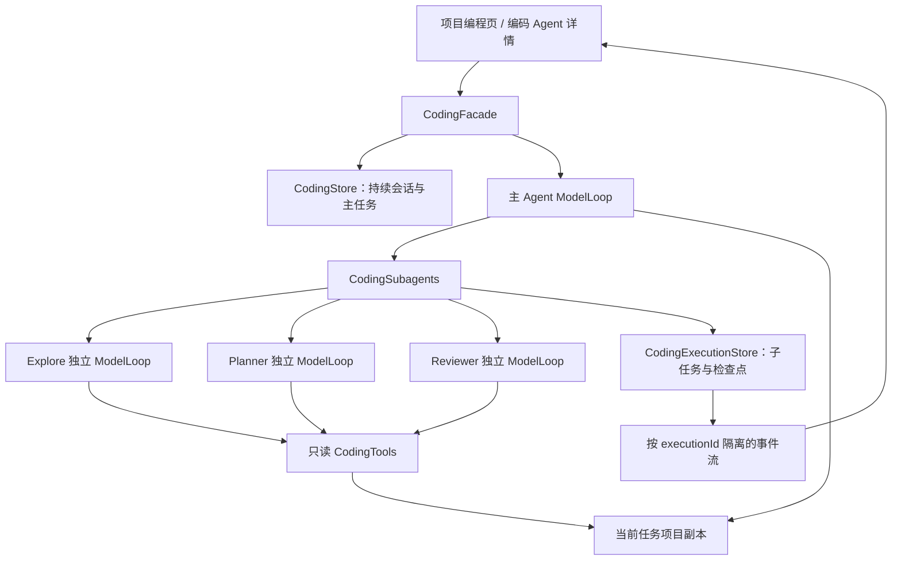
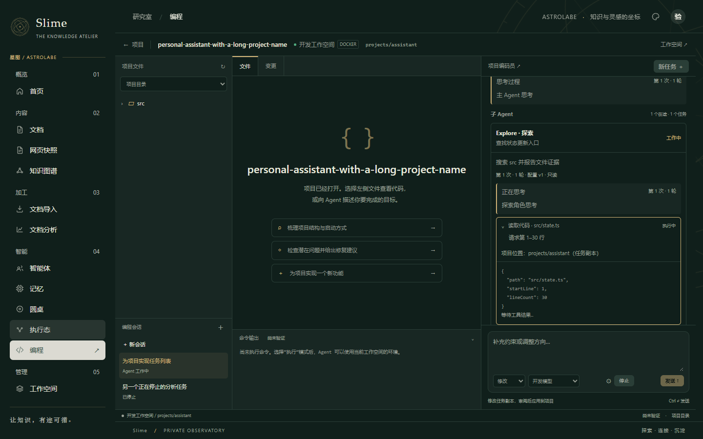
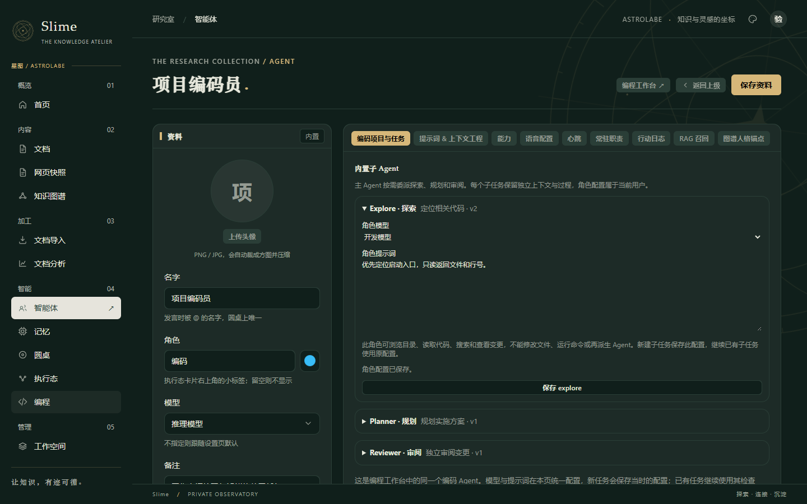
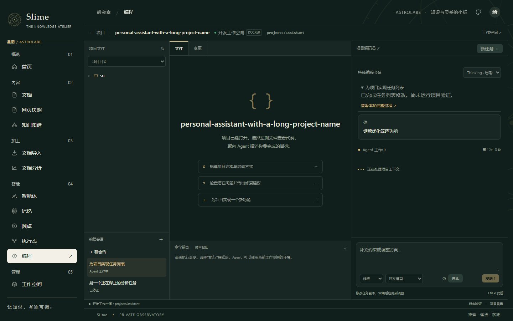
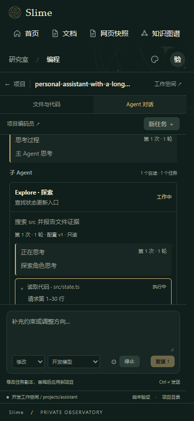

# AI Coding：持续会话与组合 Agent 第一阶段

日期：2026-10-15。

本次将原来的单一编码循环扩展为主 Agent 按需调用只读专家，并保留同一项目的持续编程会话。后端实现仍在独立的 `cc.ginpika.minis.coding` 包内，复用现有工作空间、模型设置、统一编码 Agent 身份与中立模型循环。

## 已实现的用户流程

1. 在既有工作空间打开或新建项目，进入编程页。
2. 简单任务由主 Agent 直接完成；复杂任务可以按需要调用 Explore、Planner、Reviewer，并选择等待或后台执行。
3. 编程页分别显示主 Agent 与子 Agent 的正文、模型提供的推理文本、文件读取及搜索过程。可以展开子任务、停止子任务；主任务执行期间可以接续已结束的子任务。
4. PLAN 分析完成后，选择修改或执行模式，点击“批准并实施”，在原任务与原会话继续。批准动作记录真实用户与目标模式。
5. 修改审阅并应用后，可以在同一会话输入下一项需求。新一轮继承对话上下文，重新取得项目快照；历史轮次可以查看，不能继续修改。
6. 编码 Agent 详情页维护三个角色各自的模型与提示词；模型未指定时继承主任务模型。运行中的子任务及其恢复使用创建时的配置版本。

这三个角色是编码 Agent 的内部执行角色，不会再向智能体名册添加三个永久成员。Guide 未融合进主 Agent，本次也没有加入产品帮助 Agent 或可写的 general-purpose Worker。

## 角色及权限

| 执行角色 | 用途 | 服务端权限 |
| --- | --- | --- |
| 主 Agent | 澄清目标、组织任务、实施、收集证据并交付 | 沿用 PLAN / EDIT / EXECUTE 工具授权 |
| Explore | 定位入口、符号、引用与相关文件 | 只读列目录、读文件、搜索、状态与差异 |
| Planner | 调研结构、提出步骤、取舍及验证入口 | 同上，不能批准计划 |
| Reviewer | 独立检查当前版本与差异，报告具体问题 | 同上，不能将未运行测试称为通过 |

角色提示词采用本项目自行编写的中文职责契约。社区仓库的角色分工提供设计参考，没有把其多个提示词拼接成主 Agent，也没有执行提示词中的指令。Reviewer 是本项目加入的角色，不将其宣称为该社区目录的原有角色。

子 Agent 的工具集合在模型请求及工具派发两处限制。即使模型编造修改、命令或委派调用，后端也返回 DENIED，并在子任务过程显示拒绝执行。修改角色提示词不能扩大权限。

## 执行与持久化结构

- 子执行拥有独立 messages、attempt、round、模型请求控制器、检查点与工具操作记录，避免污染主任务上下文或覆盖主任务检查点。
- 主任务与子任务共享累计 token 预算；默认累计预算仍为 0，即不设累计额度。UI 显示整个执行的累计用量。
- 子执行并发配额与主任务配额分开，避免所有主任务占满配额后等待子任务造成死锁。默认同时执行两个只读子 Agent，每个主任务最多八个在途子任务。
- 只读专家共用当前任务副本，不创建额外项目。副本文件操作使用同一互斥锁；模型请求可以并发。子任务开始、结束比较树哈希，发生变化时报告 STALE，主 Agent 必须重新核验结论。
- 后台子任务未结束时，主任务进入 WAITING_AGENTS，执行态仍显示工作中。收集后台报告后再次调用主模型，避免提前把未完成任务称为交付。
- 委派调用有幂等记录。恢复时可以列出已有子任务，读取或接续原执行，避免重复创建。
- 主任务停止、运行期限到达或关闭后端时，会取消子执行的模型请求；排队子任务同样检查取消标记。
- 后端重启将未结束的子执行标为 INTERRUPTED，只读未返回操作标为 NOT_RETURNED，不伪造执行结果。继续主任务后可以恢复原子执行。
- 子报告带执行身份、状态、版本哈希与“报告不代表用户授权”的说明。它不能改变主任务权限或批准应用修改。

本次增加 `coding_session`、`coding_session_run`、`coding_role_config`、`coding_execution`、`coding_child_operation`、`coding_delegation_request` 六张表，使用幂等建表。旧任务首次打开时补建会话关联。未更改既有表列，未操作用户的运行数据库或工作空间。

## 接口与配置

接口前缀为 `/api/coding`，沿用现有登录认证及任务所有者检查。

| 接口 | 功能 |
| --- | --- |
| `GET /sessions` | 当前用户的持续会话 |
| `GET /sessions/{id}/runs` | 会话轮次，按关联顺序返回 |
| `GET /runs/{id}/session` | 查询或补建旧任务会话关联 |
| `GET /roles`、`PUT /roles/{id}` | 当前用户的内置角色配置 |
| `GET /runs/{id}/executions` | 当前任务的子执行 |
| `POST /runs/{id}/executions/{child}/stop` | 停止一个子执行 |
| `POST /runs/{id}/executions/{child}/resume` | 原子执行检查点继续，要求主任务正在执行 |

原 `POST /runs` 增加可选 `sessionId`；原 `POST /runs/{id}/resume` 增加可选 `mode`。旧调用不必调整。进入下一轮前必须处理上一轮待应用修改；不能通过创建新一轮跳过审阅。历史轮次恢复在后端同样被拒绝。

新增配置：

| 环境变量 | 默认值 | 含义 |
| --- | --- | --- |
| `MINIS_CODING_SUBAGENTS` | 2 | 全局只读子 Agent 并发数，范围 1–8 |
| `MINIS_CODING_SUBAGENT_ROUNDS` | 30 | 子执行每次最大轮数，不超过根配置的最大轮数 |

角色每次保存增加版本号。独立模型与提示词按当前用户覆盖，服务端工具权限不提供可写配置入口。默认角色无需额外配置即可使用主任务模型。

## 页面验收截图

截图使用生产前端与拦截的测试 API，任务、模型及项目均为测试数据。

## 验证及范围

完成 74 项后端定向回归、10 项前端纯逻辑检查、27 项生产页面浏览器检查；前后端构建通过。组合执行用例覆盖独立上下文、只读工具强制约束、配置冻结、归属隔离、并行取消、委派幂等、后台回报后主循环继续、连续会话与用户批准规划。浏览器检查覆盖角色保存、过程展示层级、子任务停止、规划转实施、会话续轮、历史保护与移动端溢出。

测试使用临时 SQLite、模拟模型响应及工作空间 API，没有发送真实模型请求或改动真实项目。真实模型的工具协议、任务完成质量，以及 Docker/SSH 全链路仍需部署环境验收。更新后端、重建前端并按现有流程重启服务后，新表会在数据库初始化时建立；本次没有替用户重启服务。

当前仍未实现可写 Worker / Verifier、并行写入隔离合并、产品 Guide、LSP、MCP、自动模型路由或 Claude Code 的 Auto 权限分类器。PLAN / EDIT / EXECUTE 沿用本系统现有权限语义。此次交付是组合 Agent 的第一阶段，不能据这些回归结果宣称达到 Claude Code 的产品成熟度。
