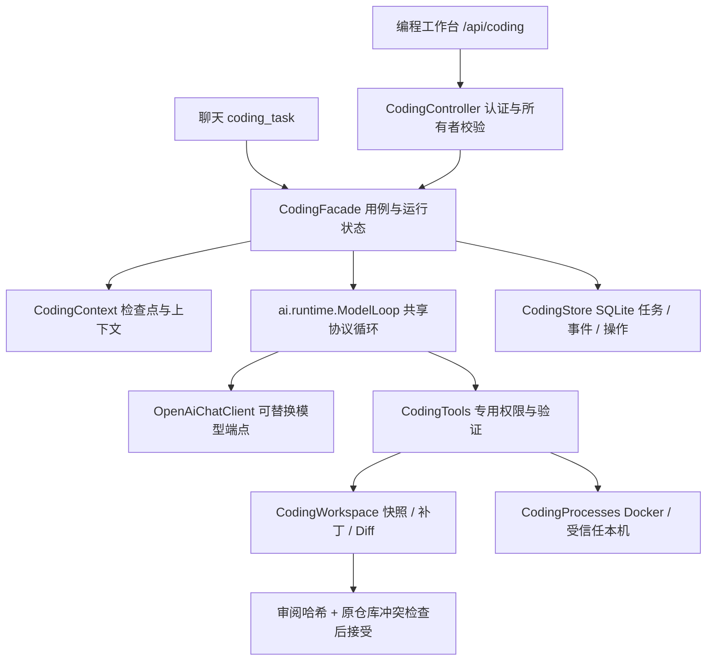

# AI Coding 首版实现与验收

**后续更新：编程入口已改为既有工作空间下的新建/打开项目，执行环境复用工作空间 Docker / SSH。** 本文保留最初基础实现记录；当前入口和环境要求以 [工作空间与项目入口](D:/Static/worktable/ginpika-page/minis/docs/AI-Coding工作空间与项目入口-2026-10-14.md) 为准。

日期：2026-10-14。路线：全面自研 Java Agent，独立包 `cc.ginpika.minis.coding`。状态：首版基础实现已落到当前工作区，前后端构建完成；真实模型、Git 文件操作及 Docker 链路仍需你的环境验收。未部署、未提交 Git、未推送，也没有调用真实模型或更新实际运行数据库。

## 1. 可以验收什么

个人助手新增“编程”导航，入口 `#/coding`。可以登记仓库、选择模型与模式、发起独立任务、查看执行过程和代码差异、补充指令、停止/继续，以及确认接受修改到原仓库。

**本次自研的是编程 Agent 系统。模型仍由已有可达端点或本机/内网模型服务提供推理。** 不依赖 Claude/Codex SDK，也不包含训练基础模型。完全离线还要求本地模型权重、推理服务、项目工具链及构建依赖都已就绪。

首版完成以下基础能力：

| 能力 | 当前实现 |
| --- | --- |
| 模块边界 | API、编程循环调用、上下文、工具、仓库、Runner、SQLite 均在 Coding 包 |
| 共享内核 | 新 `ai.runtime.ModelLoop`，旧 `AgentRuntime` 作适配，保持聊天记忆和事件行为 |
| 专用权限 | PLAN 只读；EDIT 修改副本；EXECUTE 运行命令；执行侧再次检查工具授权 |
| 上下文 | 根项目约定、用户目标保护、工具调用配对、较早工具摘要、按模型窗口检查预算 |
| 仓库快照 | 保留允许范围的脏工作区与新增文件；私有 Git 元数据与任务副本分离 |
| 补丁 | 实际文件哈希、唯一匹配、批次预检查、原子单文件替换、异常回滚 |
| 进程 | Docker 默认隔离，受信任本机模式显式开启，进程句柄、输出游标、超时、停止 |
| 持久状态 | 通用任务 kind=code，运行 attempt、模型检查点、操作审计、用户介入与事件游标 |
| 恢复 | 重启标记中断，补齐缺失工具结果，未知副作用不盲目重放 |
| 预算 | 轮数、时间、累计 token 估算、并发上限，超限暂停而非强制宣布完成 |
| 验证 | 配置命令的真实退出码与代码树绑定；未运行/失败/受阻/过期分别表示 |
| 交付 | 文件变更、二进制/截断提示、产物哈希、原仓库冲突检查和接受日志 |
| 工作台 | 流式事件和轮询补读、Markdown 回答、Diff、继续/介入/接受，兼容桌面令牌 |
| 助手接入 | `coding_task` 可列仓库、发起 PLAN/EDIT、读取状态并返回工作台入口 |

聊天中的编程工具只受理任务并返回回执；结果通过工作台或后续读取查看，尚无自动回送聊天的完成通知。聊天入口不授予命令执行权限。

## 2. 架构落点



主要源码：

- [Coding 包说明](D:/Static/worktable/ginpika-page/minis/backend/src/main/java/cc/ginpika/minis/coding/README.md)
- [CodingFacade](D:/Static/worktable/ginpika-page/minis/backend/src/main/java/cc/ginpika/minis/coding/CodingFacade.java)
- [共享 ModelLoop](D:/Static/worktable/ginpika-page/minis/backend/src/main/java/cc/ginpika/minis/ai/runtime/ModelLoop.java)
- [任务工作台](D:/Static/worktable/ginpika-page/minis/frontend/src/pages/Coding.tsx)
- [Coding 表结构](D:/Static/worktable/ginpika-page/minis/backend/src/main/resources/coding/schema.sql)

包外改动为共享循环提取、模型请求取消、认证身份的异步传递、聊天工具接线、Schema/环境配置及前端导航。没有增加 SDK 编排运行时。现有未提交的浏览器、网页快照、布局和主题工作仍然保留。

## 3. 启动与首次验收

沿用项目已有启动方式启动新版本的后端与前端，进入“编程”。本次没有启动或替换你正在使用的服务。已生成后端 `backend/target/slime-backend-0.0.1-SNAPSHOT.jar` 和前端 `frontend/dist`；普通后端 Jar 不额外嵌入前端。

### 第一步：模型与仓库

1. 设置页选择你当前可达、支持多轮 function tools 的模型。先核验端点实际协议；本地/内网兼容接口同样可以接入，不保证任意小模型的编程质量。
2. 后端须有 Java 21、Git、可写数据目录。Git 仓库必须已有 HEAD 提交；仓库路径用后端看到的绝对路径。
3. 登记一个用于验收的仓库。建议先用副本，放入一项既有未提交修改，用来核验保护行为。管理员才可登记宿主路径。
4. 本机开发身份只允许 loopback 请求；远程部署必须配置真实 SSO，不应将开发身份通过公网反向代理开放。

### 第二步：先验收 PLAN 与 EDIT

PLAN/EDIT 不需要 Docker。默认数据目录位于 SQLite 数据文件旁的 `coding`，也可设置 `MINIS_CODING_DIR`。

先用 PLAN 要求“解释某个模块，给出具体文件证据”，检查工具读取与回答。再用 EDIT 提交一个明确的小修复，检查快照、工具操作、补丁和 Diff。EDIT 不运行项目命令，验证应显示“尚未验证”。

检查任务过程中原仓库没有变化。审阅后点击“审查并接受修改”，再确认接受。接受前修改原仓库的基准文件，应得到冲突拒绝而不是覆盖。

### 第三步：验收 EXECUTE

默认使用 Docker。管理员预先准备 `MINIS_CODING_IMAGE` 对应的镜像与项目构建缓存。镜像使用 `--pull=never`，任务容器不联网；默认 Maven 镜像不提供 Node，也不会自动下载项目依赖。

后端须有 Docker CLI 和可信 daemon 连接。现有后端 Dockerfile 已增加 Git，但没有替你挂 Docker socket 或安装 Docker CLI；容器部署须明确配置可信连接。后端数据路径与 daemon 宿主路径不同的情况下，设置 `MINIS_CODING_HOST_DIR` 为对应数据根目录，确保挂载到真实任务副本。

构建缓存与工具链应提前包含在镜像里，并可在命令开头复制到可写目录。请配置与项目匹配的验证命令，避免用无网络环境下必然失败的在线安装命令作为首个验收入口。

确有需要可由管理员设置 `MINIS_CODING_LOCAL_EXECUTION=true` 使用受信任本机命令；此模式拥有宿主权限，不能等同 Docker 隔离。首版默认关闭。

验收顺序：执行简单命令并查看日志 → 项目构建 → 明确退出码与验证树哈希 → 停止一个运行中的进程 → 暂停/继续 → 重启后检查中断与残留容器清理。测试受阻时记录原因并继续检查其他功能，按你的要求不反复重试。

## 4. 核查证据

最终结果以本节为准，早期方案中的 35 项回归是实施前历史记录。

| 核查 | 结果与限制 |
| --- | --- |
| 后端选定回归 | 42 项通过，失败 0、错误 0；包含聊天适配、历史、架构边界、Coding 循环、模式权限、上下文与存储恢复 |
| 前端生产构建 | `npm run build` 通过，包含 TypeScript 检查；Vite 提示主 bundle 大于 500 kB，尚未做工作台懒加载 |
| 后端打包 | `mvnw -o -DskipTests package` 通过；测试跳过仅用于已检查后的打包阶段 |
| Git 仓库测试 | 7 项在临时 Git 元数据初始化时被工具沙箱写入权限阻断；未验收通过，已停止尝试，保留测试交给实际环境 |
| 独立启动探针 | 在隔离配置/数据库下被已有 TTS 服务的 Java loopback 连接权限阻断，未验证完整应用启动；没有继续重试或改动 TTS |
| 真实模型 / Docker / UI 端到端 | 尚未运行，不宣称通过 |

选定回归明细：ChatToolDispatcherTest 2、ChatTurnRunnerTest 3、HistoryTest 9、AgentRuntimeTest 6、LayeringTest 10、CodingEngineTest 5、CodingStoreTest 7。

当前工具环境使用显式预加载 Byte Buddy Agent 避免 Mockito 动态附加卡住。路径需按你的本机 Maven 缓存调整；在正常环境通常直接运行测试即可。

```powershell
cd backend
.\mvnw.cmd -o '-DargLine=-javaagent:C:\Users\Yuzhou\.m2\repository\net\bytebuddy\byte-buddy-agent\1.17.8\byte-buddy-agent-1.17.8.jar' '-Dtest=LayeringTest,AgentRuntimeTest,ChatToolDispatcherTest,ChatTurnRunnerTest,HistoryTest,CodingStoreTest,CodingEngineTest' test
```

另行在你的环境运行 `CodingWorkspaceTest`。它覆盖脏快照、排除文件、补丁冲突/批次原子性、源仓库冲突、接受新增文件、私有 Git 元数据、路径边界及非 UTF-8 文件。阻断来自本次工具沙箱，不代表这些行为已经验证正确。

## 5. 需要如实保留的能力边界

首版实现了自主编程闭环的控制面和基础执行链路，但还没有真实任务集的成功率、费用或与 Claude Code 的对照成绩，不能称为已经完整对标。

以下仍未实现：LSP/语义索引、嵌套目录规则解析、Skills/MCP、并行 Coding Worker、交互式 PTY/stdin、独立远程 Runner RPC、项目知识注入、模型自动路由、自动完成通知、产物下载/长期保留策略、多实例调度。补丁主要面向 UTF-8 文本；二进制变更可出现在 Diff 与受控接受流程中，但需人工审阅。

还需平台验收：Windows 链接与可执行位语义、本机后台进程清理、Docker bind mount 磁盘硬配额、重启/断网/断电期间的恢复。接受修改使用日志和异常回滚，跨文件写入不是断电原子事务；存在 `accept-journal.json` 时需人工核对，不能自动继续。

快照过滤常见凭证/依赖/产物，不能替代密钥扫描；LOCAL 具有宿主权限。Coding API 按所有者隔离，但沿用的通用任务视图不是本次重构的完整多租户边界。部署为多用户产品前需要整体权限审计。

## 6. 下一阶段的推进依据

优先完成实际模型、Git 与 Docker 验收，修复具体环境问题。随后建立固定任务集：小修复、跨文件功能、含既有改动、构建失败诊断、取消、长上下文、断网/重启恢复与原仓库冲突。记录完成率、人工修补率、真实 token/费用及耗时，再决定 LSP、并行 Worker 和模型路由的投入顺序。

完整目标与原始可行性分析见 [架构方案](D:/Static/worktable/ginpika-page/minis/docs/AI-Coding可行性与架构方案-2026-10-14.md)。
