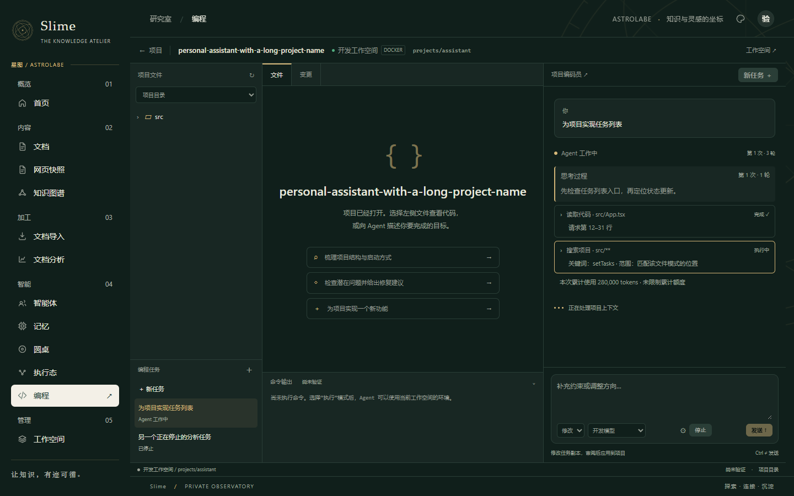
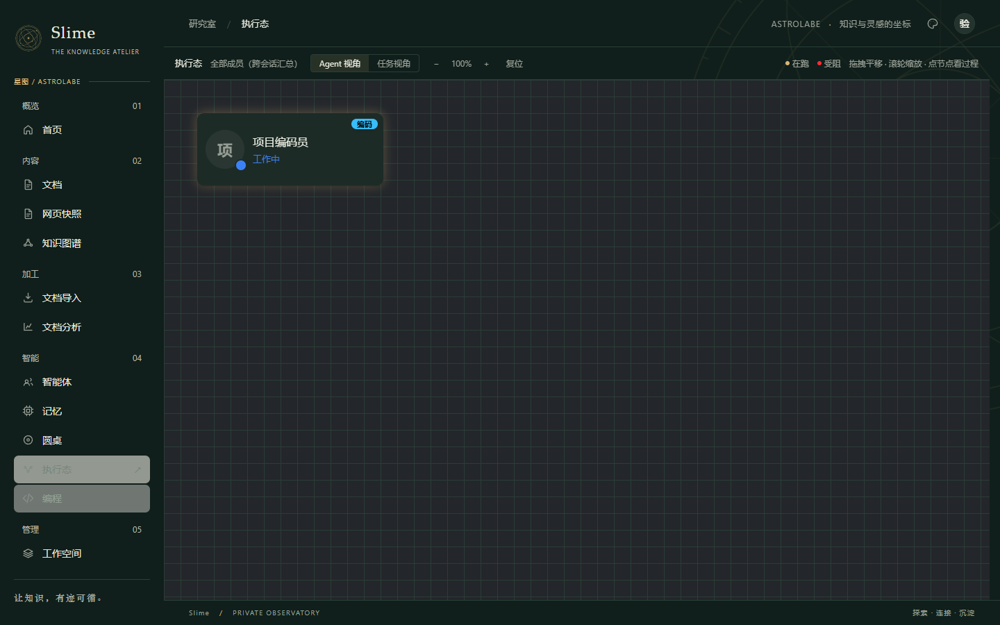

# 编码 Agent 活动状态与任务过程修复

此次解决四项使用问题：编码任务运行时执行态仍显示空闲、任务会话缺少模型思考内容、工具标题不展示实际文件和搜索范围、累计 token 额度过早暂停任务。

## 修复行为

- 执行态通过中立接口 `ai.runtime.AgentActivitySource` 聚合编码任务的待执行、执行中和已完成计数。QUEUED、准备、运行、验证、取消中、应用中均标为活动；暂停、等待审阅、停止和失败不继续标为工作中。全局视图按当前用户聚合，会话视图另外按任务绑定的 session 过滤，不泄露其他用户的编码活动。
- 编码引擎保留供应商返回的 `reasoning_content`，分开保存 `reasoning.delta`、`message.delta`，每轮保存 `reasoning.finished` 完整快照。截断响应的推理也可查看；中断保留已收到的片段。UI 按 attempt 与 round 区分思考，快照替换增量，重放不重复。模型未提供推理时不伪造思考；旧版本未保存的推理事件不能补回。
- `tool.started` 立即显示读取路径及请求行段、浏览目录、搜索关键词和 glob。`tool.finished` 更新同一个 operation，保留参数与结果，可展开审阅；历史只有完成事件时仍兼容。阅读范围是请求范围，实际文件内容可能少于请求行数。
- `MINIS_CODING_MAX_TOKENS` 默认从 200000 改为 0，关闭累计 token 硬额度。正数仍是可选的每次运行额度。优先使用供应商 usage；缺失时估算文本，不再将 JSON 转义和封装字符当作正文收费。显式额度在已经消耗额度后、下一次请求前暂停，不再提前叠加整个估算请求。页面显示累计用量、是否估算、是否设有额度。

轮数、运行时长、上下文窗口、取消、截断续接次数、工具授权和文件修改审阅仍按各自规则生效。累计额度与单次模型输出上限独立。供应商支持的输出长度仍由供应商决定。

## 配置生效

更新前后端并重启。若部署环境或 `.env` 仍显式设置 `MINIS_CODING_MAX_TOKENS=200000`，请改为 `MINIS_CODING_MAX_TOKENS=0`，因为外部配置覆盖 YAML 默认值。没有改动实际运行数据库、工作空间或服务进程。

## 核查

- 后端定向回归 58 项通过：配置实际加载与绑定、超过旧额度仍可运行、真实 usage 与估算、正数额度仍生效、推理流和中断、任务状态与身份隔离、执行态聚合、模型循环和分层约束。
- 前端逻辑检查 9 项通过：事件去重与排序、推理快照替换增量、多轮与继续任务隔离、工具开始和完成合并、读取路径/行段、搜索位置、历史事件兼容。
- 生产 App 浏览器检查 23 项通过：包含任务状态轮询、推理及工具实时展示与刷新回放、28 万 token 且累计额度关闭的展示、执行态工作中转为空闲、移动布局、四种主题及既有项目/任务流程。
- 浏览器的 API 全部由本地测试拦截，不访问真实模型或工作空间；不能代替实际供应商和 Docker/SSH 端到端验收。

