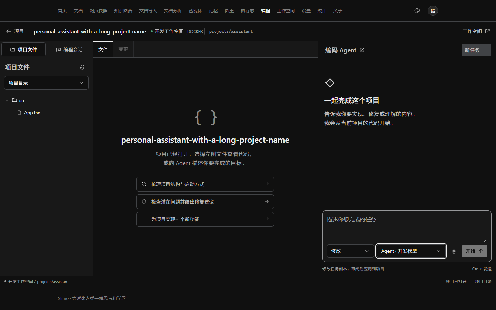
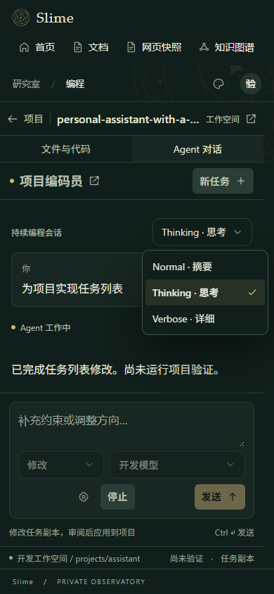
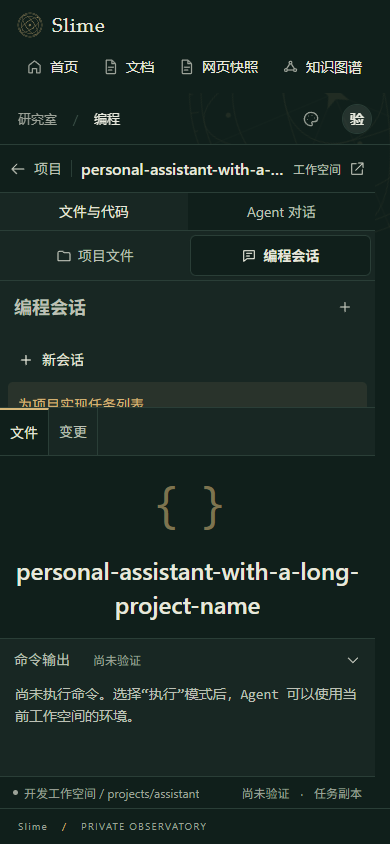
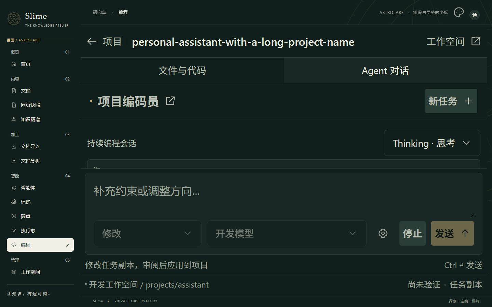

# AI Coding 页面检查与权限修复

2026-10-14。本次修复完整应用中编程页底部的 404、创建项目时错误要求管理员，以及页面状态和窄屏布局问题。没有连接真实工作空间、发起模型任务或替换运行中的服务。

## 权限提示的原因与修复

`CodingController.open()` 原先对 `POST /api/coding/projects` 额外检查 SSO 角色必须为 `admin`，返回“选择工作空间项目需要管理员身份”。工作空间 SSH 配置中的 `root` 只是远端操作系统账号，不会使当前应用用户的 SSO 角色成为管理员。该限制与既有 `WorkspaceController` / `TerminalController` 的工作空间访问方式不一致，现已移除。

普通已认证用户现在可以在现有已启用工作空间内新建和打开项目。后端从会话确定项目所有者，继续校验目标启用状态、目录边界、连接配置指纹及任务归属。未登录请求仍返回 401；远程使用 `local-dev` 开发身份仍返回 403；模块禁用仍返回 503。旧 `/api/coding/repositories` 登记后端宿主路径的管理员要求保留。

此次没有调整 SSO 角色、SSH 凭证或已有工作空间访问模型，也没有引入工作空间级用户 ACL。修改要在更新并重启后端后生效；浏览器刷新不能替换旧后端代码。

## 页面问题与结果

| 问题 | 修复后的行为 |
| --- | --- |
| 编程内容和 404 同时出现 | App 原先独立维护的 404 白名单遗漏 `/coding`；现在从 NAV 统一识别主路由，编程带查询参数的链接正常，未知路径保留 404 |
| 一个配置接口失败让整个入口不可用 | 分项加载，保留成功获取的项目/工作空间数据，显示真实错误并可重新加载；模块状态未知时禁止创建 |
| 切换任务残留草稿、文件标签或差异 | 按项目和任务重建界面状态；明确选中的新任务快捷提示可带入新任务 |
| 新功能快捷操作可能沿用分析模式 | 新功能选择 EDIT，项目分析选择 PLAN |
| 差异请求失败后一直显示加载中 | 独立错误和加载状态，显示失败原因和重试按钮 |
| 审阅确认可能使用变化后的差异 | 确认弹窗冻结本次审阅的差异与产物哈希；Tab 限制在弹窗内，Escape 可退出，应用期间禁止重复操作 |
| 取消/应用期间继续发送指令 | 禁止发送；继续任务显示当前任务的模型配置 |
| 继续任务混入旧回答流片段 | 根据 attempt 结束事件分隔回答，旧片段保留在审计中 |
| 文件标签不能关闭 | 提供关闭按钮，关闭当前标签切换到剩余标签或空预览 |
| 长项目名称、窄屏与主题侧栏挤压界面 | 工具栏截断长名称、输入控件换行，按实际容器宽度切换布局；窄屏编程页将全局侧栏改为横向导航，保留用户菜单 |

## 验证证据

- 后端 `CodingControllerAccessTest` 7 项通过：普通用户创建/打开、未登录、空身份、模块禁用、远程开发身份和旧宿主路径登记限制。通过 MockMvc 调用真实控制器，WorkspaceProjects 为模拟对象，不访问远端。
- 本次后端选定回归总计 29 项全部通过，包括上述权限测试、CodingEngineTest、CodingStoreTest 与 LayeringTest；离线 Maven 打包成功。
- 前端路由与回答状态测试 5 项通过（`npm run test:coding`）。
- 前端 TypeScript 与 Vite 生产构建通过。已有主包大于 500 KiB 的构建提示仍存在；定向 lint 无错误，有 React effect 状态同步提示。
- 完整生产 App 浏览器交互检查 15 项通过，覆盖无误报 404、项目打开/新建请求、文件预览/关闭、快捷模式、差异错误恢复、审阅哈希与键盘操作、任务切换、取消禁发、配置接口失败恢复，以及 old/endfield/bluearchive/astrolabe 四套主题在桌面及 900/390 像素窄屏的布局。无未处理页面异常。

浏览器检查不是单独组件静态渲染：读取 `frontend/dist` 的真实 App，Playwright 拦截所有页面资源和 API，使用普通用户角色的固定数据。测试不连接后端，不创建真实目录，不修改实际项目；真实接口权限由后端 MockMvc 测试另行覆盖。第一次新增能力故障用例只改变 hash，没有触发初始化请求；补充实际页面刷新后该用例通过，没有反复尝试受阻网络或文件系统测试。

浏览器脚本为 `frontend/tests/coding-browser-check.mjs`。先构建前端，再配置 `MINIS_PLAYWRIGHT_DIR` 指向含 Playwright 的模块目录，运行 `node tests/coding-browser-check.mjs`；需本机 Chrome。截图输出到 `backend/target/coding-browser-check`。

此前沙箱阻断的 7 项真实 Git 测试和 1 项原子文件替换测试没有重试。真实 Docker/SSH 快照、命令执行、取消/恢复与应用代码链路仍需部署环境验收。

## 完整应用截图

以下截图使用生产 App 与拦截数据，用于页面验收，不代表真实模型或工作空间运行结果。

## 2026-10-15：编程 IDE 交互与排版更新

- 起始页、IDE 和子角色设置统一使用 Tailwind Select 弹层，支持键盘、搜索与禁用项；文件树、会话、代码、日志、对话及弹层使用细圆角滚动条。
- 左侧“项目文件 / 编程会话”改为 Tab 切换，支持方向键、Home / End，切换保留文件树展开和滚动状态。
- 按 `ui-design-font-size.md` 调整排版：用户及 Agent 正文、思考正文和输入为 16px；交互文字 14–16px；辅助信息 12px 起；代码与终端为 14px，工具参数为 13px。使用 rem 支持字体放大，界面采用屏幕阅读用无衬线字体，代码保留等宽字体。
- 常用字符图标改为统一 SVG，修正工具栏、文件树、关闭、设置、发送与新任务按钮的对齐；带文字按钮不再套用图标按钮的固定宽度。
- 移动端文件面板和代码区上下排列；文字放大至 200% 时自动收拢为可切换面板，并限制输入区域，避免挤占全部对话阅读空间。

前端构建、12 项逻辑检查和 31 项生产页面浏览器检查通过。截图使用拦截 API 的测试数据，未执行真实模型或修改工作空间。

