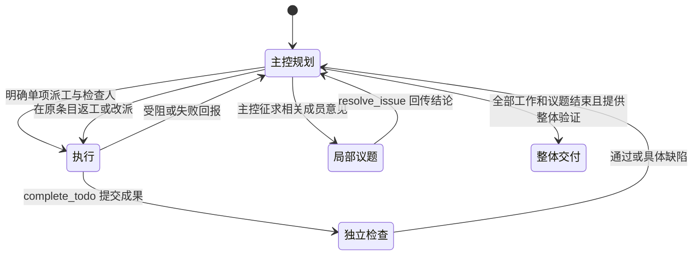

# 主控动态规划与执行检查闭环

协作保留“项目起始页 → 项目页 → 会话页”的结构。主任务由一位持久化主控管理计划，成员在分配的工作内部自主使用工具；局部议题保留圆桌讨论。

## 职责与派工

- 新任务至少两位成员，创建时明确选择主控，未提供时默认第一位成员。历史主会话在下一次用户输入时采用第一位现有成员作为主控，保留原待办、成果与执行记录；历史数据不补造验收。
- 只有主控能创建、合并、取消、修订依赖、改派工作和确认交付。合并通过修订保留条目、将被替代条目标记 dropped 实现，记录仍可查看。执行者不能直接扩张共享任务板。
- 主控先用 `manage_plan(action=revise)` 保存本次交付物、范围外事项、实查现状、整体验收标准和计划依据。未来路线图单独保存，不自动转为待办。每个待办的 detail 要说明工作边界、产出和验收方法。
- `start_work(id, reviewer, note)` 每次明确派出一个条目，负责人须已指定，检查者必须是任务内另一位成员。一次派工包含执行与独立检查，结果回报后才能派发下一项。首版按顺序推进，避免同一工作区同时改写。
- 执行者提交成果和验证结果；检查者读取实际产出并运行适当检查。检查通过才进入 done。普通回复、沉默或 propose_end 都不等于工作完成。

## 动态调整与完成

检查拒绝保留原条目、成果、具体缺陷与尝试记录，不自动执行下一次。主控读证据后决定原条目返工、改派、调整依赖、取消或请求用户。检查通过只满足依赖条件，下游仍须主控明确派工。依赖必须存在于本任务，修订时拒绝循环依赖；同名条目会提示修订原条目。

`collaboration_plan` 持久化主控、验收标准、阶段、最近依据、整体证据和单项派工。每次派工及用户明确调整工作递增版本，旧 worker 的收尾不能结束新派工。普通问答保留版本与原派工。主控决定以 `plan_decision` 通知进入主消息流，执行检查继续复用原有运行记录。

所有 TODO 结束仅代表主控可以核对整体目标。只有不存在未完成工作与开放议题，并提供实际整体验证 evidence，主控才能 `manage_plan(action=finish)` 确认交付。证据是模型提交的检查说明，系统不能仅凭非空文本保证验证真实性；真实任务仍需核对工具调用和实际产物。

## 会话范围与逐步规划

项目提供长期方向，会话定义本次推进目标，TODO 是当前可独立验收的一步，议题只解决局部问题。上下文分别标记这些概念，并读取同项目已交付成果作为核对线索，要求先检查实际文件，不能机械地从零重建。

保存计划、新增或改变 TODO、派工、整体交付时，独立的范围复核判断是否符合人类当前目标。技术选型会话应围绕比较、风险、决策和关键假设的最小实验，不自动扩张到完整玩法、服务端或桌面封装。多个可分别验收的阶段不能塞入同一 TODO；未来路线图可以保留，但不自动执行。

复核结果按人类要求、范围、任务证据与派工版本缓存。目标或任务状态变化后重新复核；无效回复、服务失败或检查期间目标变化均不允许创建或派发工作。它是额外的语义判断，不能保证模型绝不误判；人类可以明确调整本次目标。

## 编码成果的执行、检查与应用

绑定项目后，仅当前派工的执行者可经 coding_task 使用 EXECUTE，且只能使用绑定的仓库。主控先派工；检查者不能接管执行者身份。普通聊天仍采用 PLAN/EDIT，不能通过模型参数自行升级命令权限。

执行者在同一待办的同一编码副本中修改并运行验证。固定的项目验证命令优先；没有固定命令时，具备有效协作执行授权的任务可记录本次构建和测试命令。普通任务不能借此覆盖用户验证设置。提交前检查真实运行状态、验证退出码和产物树哈希；EDIT 的文字自述不能替代实际执行。

检查者读取该副本的 diff 与操作记录，再执行 verify，在同一副本实际重跑已记录命令，不能复用执行者的验证缓存。检查凭据绑定检查人、派工版本、命令、实际报告和产物哈希。review_todo 接受前由服务端校验凭据并应用该副本，应用冲突或成果变化则保留检查状态；应用成功后才进入 done。拒绝时保留副本供原待办返工，不创建重复分叉。

项目目录、派工版本、成员名单或用户继续状态失效时，执行权限撤销并停止在途命令。此流程没有额外授予推送、部署或操作其他项目的权限。

CollaborationCodingLoopTest 使用真实临时 Git 工程、实际 npm 构建和 Node 测试，覆盖独立重跑、同副本应用和旧检查凭据失效。模型生成与工作空间传输使用替身。CollaborationScopeLiveTest 是显式启用的联网语义验收，默认跳过，不随常规回归访问外部模型。

## 受阻与议题

执行受阻先集中回报主控，不自动为每个条目建立补救议题。主控归并共同原因，优先修订已有工作；需要设计意见时明确调用 `request_discussion`，只召集相关成员，已有开放议题时不重复创建。

议题拥有独立消息与主任务上下文快照，不能另建任务板或递归建议题。结论以通知回传主任务并进入关联条目的说明，由主控决定如何应用，不直接将 blocked 改回 pending。用户仍可手动发起、阅读与提交议题结论。

## 停止与边界

- 任务尚未建立验收标准时，首条目标进入主控规划。建立计划后，普通发送由成员按本条用户消息的语义判断：普通问答保持原派工与暂停状态；明确恢复、重试、调整或停止指令通过 `control_collaboration` 提交控制请求，不做关键词匹配。用户勾选「调整任务」（`redirectWork=true`）仍可直接进入重新规划。
- 普通消息按当前会话成员解析 @，由被点名成员依次回复；未 @ 时由主控回复。对话仍走会话议程，但与执行 worker 并行。对话具有只读工具和工作控制请求工具，不直接改任务板、文件或授予工作空间权限。控制请求必须引用当前用户消息原文，生成结束后由运行时重新核对会话版本、停止状态、消息和成员，再执行停止或重规划；原消息转为工作指令，不重复插入。普通 `conversation` 消息仍不充当后续工作范围的要求。
- 回复注入有时间标记的工作快照：原派工、执行状态、同一会话内关联编码任务的状态、轮次、验证结果与最近工具操作。不读取内部思考，不编造完成百分比或剩余时长；拟人化关心仍按成员人格自然回应。主控可查看本会话各执行者事实，普通成员读取自己的编码记录。
- 「停止协作」明确取消执行与当前对话，并作废已排队的旧回复；普通插话不会触发它。迟到工具调用继续受会话版本与当前派工约束，不能覆盖新要求。
- 请求用户与用户停止均暂停自动领取；议题结论不会解除用户暂停。主控未明确派工、发起议题、请求用户或确认交付时，显示原因并暂停，不假装持续推进。
- 调度步和条目尝试只记录过程，不再因达到 24 步或 3 次而停止。受阻由主控读取具体原因后决定原条目返工、调整计划或请求用户。
- 模型执行不设工具往返轮数与固定字符预算；上下文按模型 token 窗口压缩。取消、权限检查、真实失败、编码任务配置的时间与成本预算继续有效。
- 进程重启会把 doing/checking 收为受阻、撤销遗留派工并暂停，不重放可能有副作用的工作。已确认交付的任务不会因重启重新开启。

## 离开页面与断线恢复

`ask_user` 暂停其他执行，让提问者正常保存自己的发言。真正被取消时，圆桌会把 `speak` 工具已收集的段落作为可保存内容，避免普通正文为空就丢掉整次发言。保存的 `ask_user` 事件在连续阅读中始终可见，用户能读到需要决定的问题。

前端对当前会话独立回读消息与话题：前台每 3 秒、后台每 15 秒；恢复网络、重新聚焦或切回可见窗口时立即补载。议题回读自己的会话，不依赖父任务协作图事件变化。读取超时为 15 秒，失败保留现有内容和草稿，后续继续恢复；恢复只读取正本，不重新发送用户消息。流已结束时，话题状态以服务端回读为准；旧请求的收尾不能覆盖新一轮直播。

## 回退对话

用户消息下提供回退按钮：删除当前会话中该提问及其后续对话，将提问回填为未发送草稿；失败时保持对话和草稿原样。主任务与开放议题均支持，已形成结论的议题继续保持只读。

这是一项对话操作：项目目标、待办、独立议题及其入口和结论记录保留，已执行的工具或文件变更不会撤销。服务端同时撤回被删消息和同期执行所派生的记忆、清除相关执行检查点，关闭旧话题并暂停当前会话；重新发送时开启新的讨论，旧等待状态和直播快照不会重新出现。

当前任务及关联议题仍在讨论、排队或执行时拒绝回退；只接受本会话的用户消息 ID，普通会话的回退入口也不能绕过多 Agent 的运行检查。

## 如何评估有效性

可选择一个有明确验收条件的小任务，让至少两位有相应工具和工作空间权限的成员协作。观察以下事实：

1. 执行者提交产出后，待办进入待检查；另一位成员实际读取产出或运行检查。
2. 检查发现缺陷后，主控收到具体意见并决定原条目返工，执行者读到返工依据，用户无需再发一句“继续”。
3. 出现分歧时，主流中出现议题卡片；议题结论回流到原待办，后续执行读到决定。
4. 缺少证据或权限时明确受阻；停止后不再领取下一条；尝试和推进计数不强制中止任务。

`RoundtableAutonomyTest` 使用真实 SQLite、事件总线和工作调度器，模型生成使用确定性替身，覆盖上述状态和调度回路；它不能证明真实模型一定会正确检查证据，也不能证明多 Agent 比单 Agent 更省时或更省 token。实际质量、端点并发和成本仍需用真实任务对比。此版没有新增跨任务学习、自动修改系统提示词或自我修改代码的能力。

## 2026-10-17：指令回执、验收契约与失败诊断

`coding_task` 的工具校验与执行共用 `CodingTaskCommand`。`start` 使用 `prompt`；`resume`/`message` 使用 `input`，历史调用的 `prompt` 会被显式规范化并在响应中说明。两字段冲突、未知参数、错误类型及模式在任何派工重绑定之前拒绝。`message` 不接受模式切换。续跑预检（运行状态、快照、应用日志、未知副作用、容量）通过后才撤销旧复核记录。

`coding_instruction_receipt` 独立于历史输入表保存可信来源、请求键、目标 attempt 和请求模式。接收后返回实际 `acceptedInput` 与 `ACCEPTED`；输入和上下文检查点一同落库后才成为 `APPLIED`。`read` 的 `instruction` 字段展示最新回执；相同请求键不会重复开启执行。来源由后端设置为 USER、AGENT 或 COLLABORATION_AGENT，旧记录来源不明时标为 LEGACY_UNKNOWN；正文声称“用户新指令”不改变权限。

新工作建议携带 `contract`：一个 outcome、带稳定 id/text 的 acceptanceCriteria，以及 stopCondition。历史 detail 继续有效，不为补字段重做旧成果。有契约的工作拒绝验收时须提供结构化 findings：id、BLOCKER/MINOR、location、expected、basis。仅有 MINOR 不能拒绝。问题按 id 保留，后续检查不能默默丢弃旧阻塞项；通过后保存解决证据与版本，一般建议保持为建议。契约、问题和诊断保存在 `collaboration_task_quality`，进入主控/执行者上下文，并在工作详情中展开查看。

收敛判断依据事实，不设置“最多返工几次”：

- 两次已结束执行的产物、已应用指令、验证命令与失败证据完全重复，再收到相同续跑要求时返回 NEEDS_DIAGNOSIS；有新产物、新要求或不同失败证据时继续正常处理。
- 同一编码产物反复收到相同结构化阻塞意见时，将原 TODO 标为 blocked，保留问题和副本，回报主控诊断。
- 独立复核通过后，如果当前项目的受检路径和未改动基准文件均符合已检查产物的最终内容，则逐路径复核哈希、文件模式和删除状态，补记 EXISTING_CONTENT 应用凭据，不重复写入项目；远程目录另做实时路径复核，不能只凭快照确认。部分已复制、其他基准文件变化或任何真实差异均不能走此确认路径。应用冲突时记录 APPLICATION_CONFLICT、runId、artifactHash 和实际错误。TODO 不会误标 done，不自动另建实现、不删除真实依赖。缺少独立复核则保持检查状态，要求先 verify，不误报应用冲突。
- 诊断只把当前派工交回主控，不暂停其他会话。主控明确再派工后记录处理依据；验收完成后诊断标为已解决。

成员在能力页显式绑定的工作空间授权在协作中同样生效：每次调用实时读取授权名单，终端仅使用当前项目绑定的工作空间和根目录；撤销授权后拒绝后续调用。内置主 Agent 自动取得工作空间目录。编码修改仍应走当前授权的 coding_task 副本，独立检查后由系统应用。SSH/LOCAL 上的任意命令拥有配置的 OS 账号权限，工作目录本身不是文件系统沙箱。

移动项目文件并重新绑定工作目录后，旧派工失效，原 TODO 与旧编码副本保留。主控可在规划阶段提供 reason，将 blocked、dropped 或 done 的原条目重开为 pending，并重新派工。当前派工的副本列表、重复副本检查、提交和应用只计入当前绑定仓库的副本，旧目录副本不能续跑、复核或应用到新目录，也不能阻塞新副本创建。

验证按任务实际风险选择命令，项目固定命令仍优先；精确树哈希与命令相同且中间没有使证据失效的执行时复用已有结果，独立检查强制复跑。文档修改没有获得“跳过验证”的自动豁免，也未引入跨版本复用测试成功的推断。

任务的新增/修订与契约、检查状态与问题证据、受阻状态与诊断、重新派工与处理依据，分别在短数据库事务内提交；耗时模型范围复核和项目应用不放进数据库事务。耗时工具返回后再次核对会话版本与继续状态，旧请求不能用诊断结果影响新派工。

本次只修改实现与新增幂等建表。运行数据库未被直接改写，原会话未被自动续跑。需要重建并重启后端、加载新前端后使用；旧派工不会凭空补造回执、契约或历史诊断。
